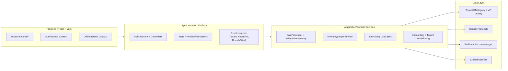
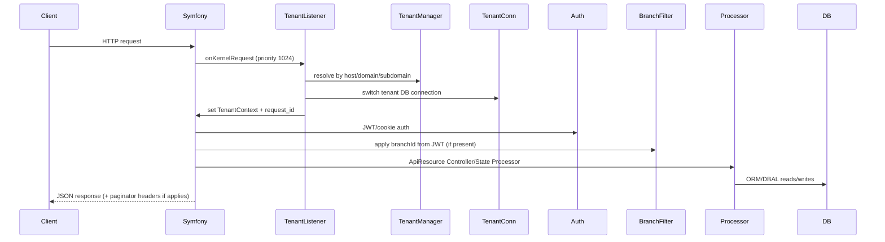
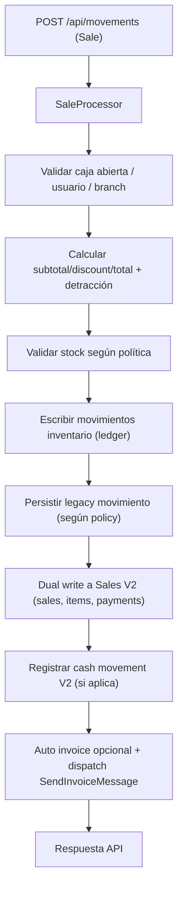
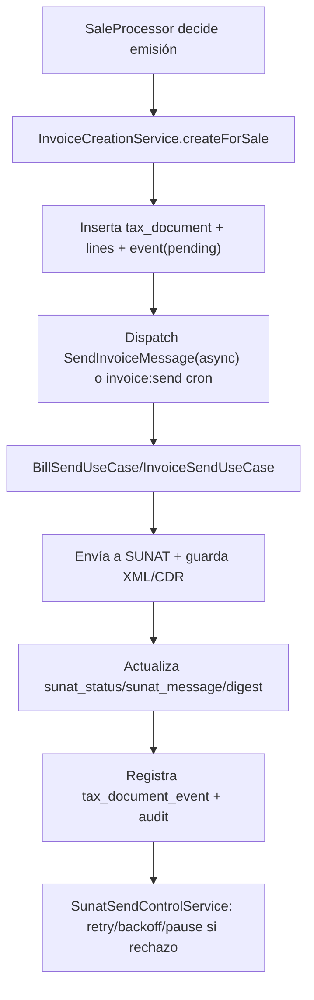
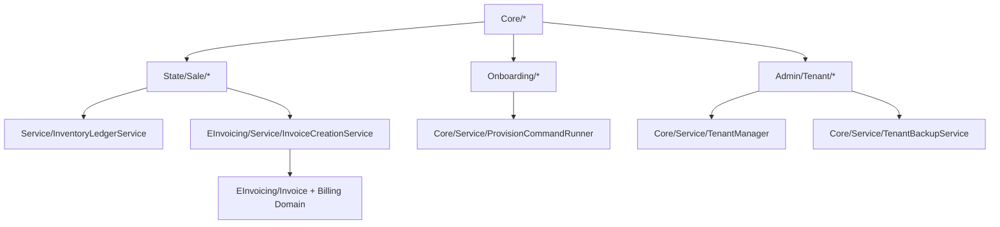
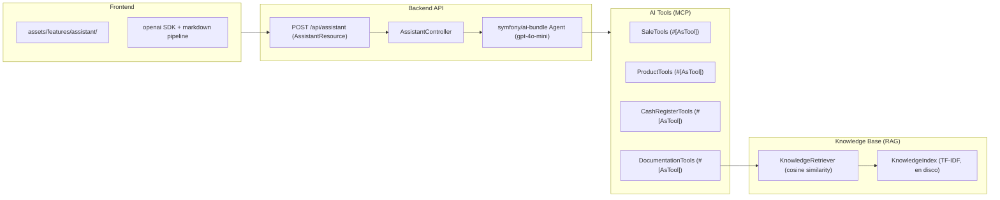

# EFACT_TECHNICAL_ARCHITECTURE

## System Overview

eFact es un SaaS POS/facturación electrónica construido como **monolito Symfony + API Platform + React** con estrategia **database-per-tenant** y un **control plane** separado lógicamente (misma app, conexión `control_plane` distinta).

- Backend: Symfony 7.4, API Platform, Doctrine ORM/DBAL, Messenger, Scheduler.
- Frontend: React 18 + DevExtreme + Vite + PWA.
- DB: MariaDB (tenant DB + control_plane DB).
- Cache/colas: Redis (`cache.app` y `MESSENGER_TRANSPORT_DSN`).
- Facturación electrónica: módulo `src/EInvoicing/*` (SUNAT).

Arquitectura observada:

- Predomina **monolito modular pragmático**.
- Hay elementos de **DDD** en `EInvoicing/Billing/Domain` y `EInvoicing/Invoice/Domain`.
- Hay elementos de **vertical slice** en frontend (`assets/features/*`) y API state processors (`src/State/*`).
- No hay separación hexagonal estricta global; existen múltiples accesos DBAL directos desde servicios/controladores.

## Domain Model Breakdown

### 1) Empresas / tenants

- Control plane:
  - `tenants` (id, name, connection, status, plan, backups, etc.).
  - `tenant_domains` (dominio por tenant, uno primario).
  - `plans`, `accounts`, `account_tenants`, `tenant_provisions`, `subscriptions`, `payment_events`.
- Tenant runtime:
  - Cada tenant apunta a su propia base (`tenants.connection`).

### 2) Sucursales

- Entidad `Branch` (`local`) vinculada a `Company`.
- Filtro por sucursal vía JWT (`branchId`) + `BranchFilterSubscriber` + `BranchFilter`.

### 3) Caja / sesiones

- Modelo legacy: `cash_shift`.
- Modelo V2: `cash_sessions`, `cash_movements`, `cash_counts`.
- `SaleProcessor` exige caja abierta según setting `REQUIRE_CASH_REGISTER`.

### 4) Productos / inventario

- Legacy: `producto`, `product_stock`.
- V2: `stock_movements` (fuente de verdad), `stock_balances`, `stock_items`.
- Política de stock negativo configurable:
  - `INVENTORY_NEGATIVE_STOCK_POLICY` (settings tenant).
  - `tenant_inventory_policy` (inventory core phase1).

### 5) Ventas

- Legacy: `movimiento` + `movimiento_detalle` (`Sale`, `SaleItem`).
- V2: `sales`, `sale_items`, `sale_payments`, `sale_discounts`, `sale_taxes`.
- Dual write configurable (`SALES_V2_*` settings + `SalesWritePolicyResolver`).

### 6) Comprobantes electrónicos (SUNAT)

- `tax_document`, `tax_document_line`, `tax_document_event`.
- Emisión desde venta: `InvoiceCreationService`.
- Envío SUNAT: `BillSendUseCase`/`InvoiceSendUseCase`/`SendInvoiceCommand`.

### 7) Clientes / proveedores

- `Customer` (`cliente`) con validación RUC/DNI.
- `Supplier` (`proveedor`) para compras y recepciones.

### 8) Usuarios y roles

- `User` (`usuario`) + `Role` (`rol`).
- Mapeo de roles por `rol_id`:
  - `1 => ROLE_SUPER_ADMIN`
  - `2 => ROLE_ADMIN`
  - `3 => ROLE_CASHIER`

### 9) Core vs verticales / e-invoicing / POS / ERP features

- `src/Core/*`: utilidades transversales (tenant context, rate limit, audit, infra, seguridad).
- `src/EInvoicing/*`: vertical de facturación SUNAT con mayor diseño por casos de uso.
- `src/State/Sale`, `src/Service/InventoryLedgerService`: núcleo POS transaccional.
- `Onboarding` + `Admin/Tenant`: capacidades SaaS/ERP (planes, suscripciones, backup, cuotas, onboarding).

### 10) Capacidades solicitadas (estado real)

- Multi-branch: **sí** (`Branch`, filtros y FKs V2 por `branch_id`).
- Multi-warehouse: **sí** (`Warehouse`, `stock_balances`, `stock_transfers`).
- Stock negativo: **sí, configurable** (BLOCK/WARN/ALLOW, con enforcement en `SaleProcessor` e inventory policy).
- Productos preparados (platos): **parcial**.
  - Existe `COMPOSITE` y `RECIPE_CONSUMPTION` en inventory core.
  - No se observan tablas/servicios completos de recetas BOM en producción.
- Lotes (farmacias): **no implementado** (no hay tablas de lotes/expiración).
- Servicios sin stock: **sí/parcial**.
  - `product_type`/`track_inventory` en migración inventory_core.
  - Flujo actual también usa convención legacy `tipo_id != 1` para no descontar stock.

## Architecture Diagram

## Request Lifecycle

Notas:

- `TenantListener` ignora rutas como `/admin`, `/register`, `/account`, webhooks.
- Si host es IP privada/localhost, puede omitir tenant switch.

## POS Sale Lifecycle

## Electronic Invoice Lifecycle (SUNAT)

## Multi-tenant Strategy

### Identificación de tenant

- Principal: host/domain (`TenantListener` + `TenantManager->getTenantByDomain()`).
- Fallback: subdominio (`getTenantByName()`).
- Token JWT también lleva `tenantName`; se valida mismatch en `JWTAuthenticator`.

### Separación de datos

- **Database per tenant**: conexión `tenant` cambia `dbname/user` dinámicamente (`TenantConnection::switchTenantParams`).
- **Control plane** separado: conexión `control_plane` con tablas globales SaaS.
- No se usa `tenant_id` en tablas operativas del tenant DB.

### Migraciones / seeds / onboarding

- Migraciones tenant: `app:tenants:migrate`.
- Migraciones control plane: `app:control-plane:migrate`.
- Provisioning automático: `app:tenant:provision` (crea DB, usuario DB opcional, registra tenant/domain, migra, setup inicial).
- Onboarding self-service:
  - UI `/register/*` + pagos (`PayPal`, `MercadoPago`).
  - `ProvisionTenantMessage` por Messenger.

## Module Dependency Map

Observaciones de acoplamiento:

- Alto uso de DBAL SQL directo en módulos de negocio (`State`, `Onboarding`, `Admin`, `EInvoicing`).
- Dependencias cruzadas fuertes entre POS y e-invoicing en `SaleProcessor`.

## Database Design Analysis

### Diseño real coexistente

- **Legacy operativo**: `movimiento`, `movimiento_detalle`, `product_stock`, `cash_shift`.
- **V2 operativo**: `sales*`, `returns*`, `stock_*`, `cash_sessions*`, `goods_receipts*`.
- **Fiscal**: `tax_document*`.
- **Control plane**: `tenants*`, `plans`, `accounts`, `subscriptions`, `tenant_backups`, `tenant_usage`, `tenant_notification_*`, etc.

### Fortalezas

- FKs y constraints crecientes (guardrails empresariales).
- Idempotencia/offline metadata en tablas write-heavy (`idempotency_key`, `local_uuid`, `sync_status`).
- Diseño de inventario tipo ledger con balance materializado.

### Riesgos

- Coexistencia legacy + V2 prolongada eleva complejidad operativa.
- Varias migraciones aplican ajustes condicionales por esquema variable (riesgo de drift entre tenants).

## Infrastructure Overview

- `docker-compose.yml` (dev): `web`, `database`, `redis`, `vite`, `otel-collector`.
- `docker-compose.prod.yml` (prod/stg): `web`, workers (`worker_async`, `worker_scheduler`), `database`, `redis`, `otel-collector`.
- Server: FrankenPHP + Caddy (`docker/frankenphp/Caddyfile`).
- Entry point productivo ejecuta migraciones control_plane + tenant al arranque (con tolerancia a fallo).
- S3 (Flysystem) para uploads y backups.
- Backups:
  - `TenantBackupService` usa `mariadb-dump | gzip`.
  - almacenamiento local o S3 (`tenant_backups` en control plane).
  - scheduler por `backup_frequency`.
- Redis:
  - cache app (`cache.adapter.redis`).
  - messenger async por DSN Redis.

## Testing Strategy

Estado actual:

- Backend: PHPUnit amplio (`tests/*`) + cobertura (`phpunit.coverage.xml`).
- Frontend unit: Vitest (`assets/**/*.test.ts(x)`), cobertura mínima 85/80 en targets definidos.
- E2E: Playwright con seed/reset dedicado. Specs activos:
  - `e2e/happy-path.spec.ts` — flujo POS completo de 9 pasos (login → producto → precio → caja → cliente → venta → movimiento → editar movimiento → cierre caja).
  - `e2e/auth-invoice-workflow.spec.ts` — pruebas API-level de autenticación y comprobantes electrónicos.
- Calidad: GrumPHP (`php-cs-fixer`, `phpcs`, `phpmd`, `phpstan`, `phpunit`).
- CI/CD: GitHub Actions (`ci-main.yml`, build image, deploy por entorno).

Brechas:

- ✅ Resuelto: `tsc --noEmit` ya se ejecuta en CI (`ci-main.yml`, job "Frontend Lint, Tests & Coverage"). Esta deuda técnica ha sido resuelta.
- E2E coverage funcional: se cuentan dos specs activos — `e2e/happy-path.spec.ts` (flujo POS completo de 9 pasos) y `e2e/auth-invoice-workflow.spec.ts` (API auth + comprobantes). Cobertura aún parcial respecto a todos los flujos críticos del sistema.

Estrategia mínima enterprise-ready sugerida:

1. Agregar job `yarn tsc --noEmit`.
2. Definir smoke E2E por dominio crítico: login, apertura caja, venta, emisión SUNAT, backup restore dry-run.
3. Publicar reporte de cobertura consolidada (backend+frontend) y trend en CI.
4. Contratos API críticos con pruebas de regresión por OpenAPI snapshot.

## Módulo AI y MCP

### Asistente AI (Backend)

- **Bundle:** `symfony/ai-bundle dev-main`, modelo OpenAI `gpt-4o-mini`.
- **System prompt:** `prompts/assistant.md` (cargado por configuración del agente `ai.agent.default`).
- **Endpoint:** `POST /api/assistant` — `AssistantResource` → `AssistantController` invoca el agente IA.
- **Configuración:** `config/packages/ai.yaml` con agent default y toolbox habilitado.

### Pipeline RAG (Retrieval-Augmented Generation)

- `KnowledgeIndex.php` (`src/AI/Knowledge/`) — carga índice TF-IDF desde disco (serializado).
- `KnowledgeRetriever.php` — búsqueda por similitud coseno; devuelve top-K fragmentos relevantes con atribución de fuente.
- `DocumentationTools.php` — expone la búsqueda RAG como herramienta disponible para el agente.
- **Construcción del índice:** comando `BuildKnowledgeIndexCommand` (ejecutar manualmente para regenerar).

### MCP Tools (Backend)

Los cuatro tools del agente se registran con el atributo `#[AsTool]` de `symfony/ai-bundle`:

| Clase | Namespace | Descripción |
|---|---|---|
| `SaleTools` | `src/AI/Tool/` | Resumen de ventas por rango de fechas y últimas N ventas |
| `ProductTools` | `src/AI/Tool/` | Búsqueda y consulta de productos |
| `CashRegisterTools` | `src/AI/Tool/` | Estado de la caja registradora activa |
| `DocumentationTools` | `src/AI/Tool/` | Búsqueda en la base de conocimiento RAG |

### MCP Bundle

- **Paquete:** `symfony/mcp-bundle dev-main`, registrado en `config/bundles.php` como `McpBundle::class`.
- **Configuración:** No existe `config/packages/mcp.yaml`. El bundle opera sin configuración YAML explícita.
- **Registro de tools:** puramente vía atributo `#[AsTool]` en las clases del directorio `src/AI/Tool/`.
- **Brecha conocida:** La ausencia de `config/packages/mcp.yaml` implica configuración implícita; el comportamiento exacto del bundle sin este archivo no está documentado internamente.

### Frontend AI

- **SDK:** `openai ^5.12.0` — cliente OpenAI directo desde el frontend.
- **UI:** `assets/features/assistant/` — chat UI del asistente IA.
- **Renderizado Markdown:** pipeline completo con `marked ^16.1.2` + `remark-parse` + `remark-rehype` + `rehype-stringify` para formatear respuestas del asistente.

### Diagrama de flujo AI

## Deployment Flow

1. `ci-main.yml` valida backend/frontend/e2e.
2. `build-image.yml` construye imagen inmutable GHCR (`@sha256`).
3. `deploy-dev.yml` despliega desde `main`.
4. `deploy-staging.yml` promueve por tag `v*.*.*-rc*`.
5. `deploy-prod.yml` promueve por tag `v*.*.*`.
6. `deploy.yml` despliega stack vía Portainer y ejecuta healthcheck `/health`.

## Known Technical Debt

1. Clases muy grandes:
   - `src/State/Sale/SaleProcessor.php` (~669 líneas).
   - `src/Core/Service/TenantManager.php` (~882).
   - `src/Admin/Tenant/TenantController.php` (~947).
2. Duplicación de lógica de idempotencia/offline UUID:
   - `SalesWriteGateway`, `GoodsReceiptWriteGateway`, `InventoryLedgerService`.
3. Boundary leakage:
   - SQL DBAL directo en controladores/servicios de aplicación.
4. Inconsistencias de código/config:
   - `config/services.yaml` referencia `config/tenant_plans.php` inexistente.
   - README previo menciona estructuras/módulos no existentes (`src/Billing`, `assets/admin` raíz).
   - `assets/api/auth.tsx` contiene mock legacy coexistiendo con login real por `features/auth/services`.
5. Caddy/TLS multi-tenant:
   - no hay plantilla explícita por tenant en repo (depende de `SERVER_NAME`/entorno externo).

## Refactor Opportunities

1. Extraer orquestadores de `SaleProcessor`:
   - pricing, inventory validation, legacy persist, v2 persist, invoicing trigger.
2. Introducir librería shared para `offline metadata/idempotency key`.
3. Consolidar acceso a control_plane vía repositorios dedicados (reducir SQL ad-hoc).
4. Materializar capa de dominio POS V2 (agregados sales/cash/inventory) para reducir reglas dispersas.
5. Completar inventory core en entidades Doctrine (`product_type`, `track_inventory`, `base_unit_id`) para eliminar dualidad con `tipo_id`.

## AI Agent Hints

### Cómo agregar nueva feature POS

1. Crear vertical frontend en `assets/features/<feature>`.
2. Exponer endpoints en API Platform (`ApiResource` + `State Provider/Processor`) o controller específico.
3. Persistir en esquema V2 primero; decidir política dual-write si toca legacy.
4. Añadir pruebas:
   - unit backend,
   - integración processor/service,
   - al menos un test frontend (Vitest) y/o e2e.

### Cómo agregar vertical

1. Backend:
   - `src/<Vertical>/Domain` (use cases/contratos),
   - `src/<Vertical>/Infrastructure` (adapters),
   - `src/ApiResource` y `src/State` para entrada API.
2. Frontend:
   - `assets/features/<vertical>/pages|services|model`.
3. Mantener dependencia unidireccional: `Core` -> shared, vertical -> core, no acoplar verticales entre sí sin interfaz.

### Cómo agregar nuevo endpoint

1. Si es CRUD/flujo API Platform:
   - crear/actualizar `ApiResource` con operación.
   - implementar `Provider`/`Processor` en `src/State/*`.
2. Si es operación custom:
   - crear controller en `src/Controller` y mapear operación `ApiResource` o route attribute.
3. Validar seguridad:
   - firewall `/api`,
   - reglas de acceso y tenant context.

### Cómo modificar modelo DB correctamente

1. Crear migración tenant (`migrations/`) o control plane (`migrations_control_plane/`) según alcance.
2. Verificar compatibilidad dual legacy/V2 (si aplica).
3. Agregar índices/FKs/idempotencia desde migración (evitar post-fix manual).
4. Actualizar servicios que usan SQL directo (DBAL) y entidades Doctrine afectadas.
5. Añadir pruebas de regresión sobre la nueva estructura.

