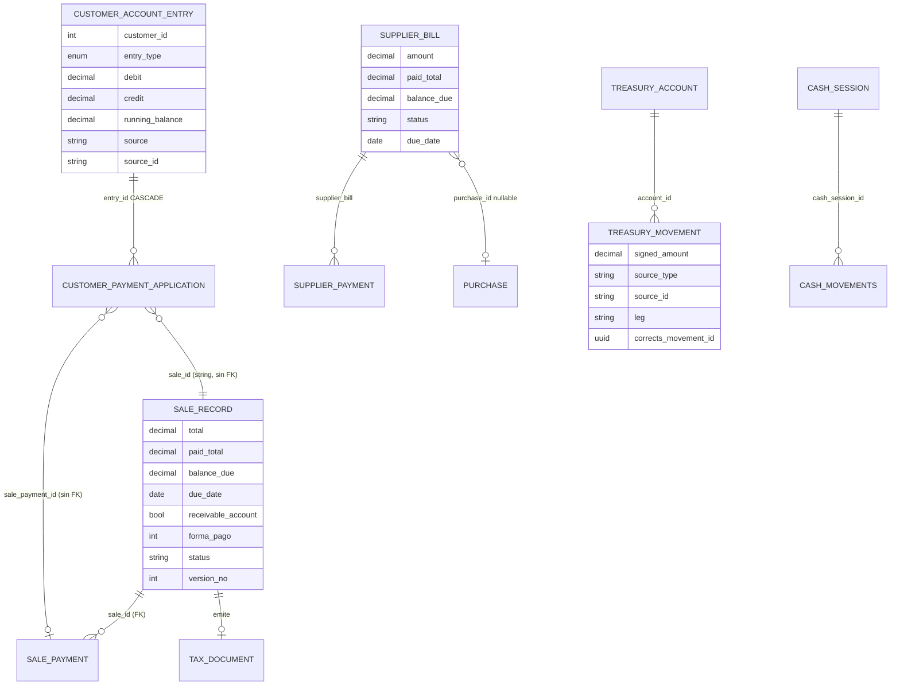
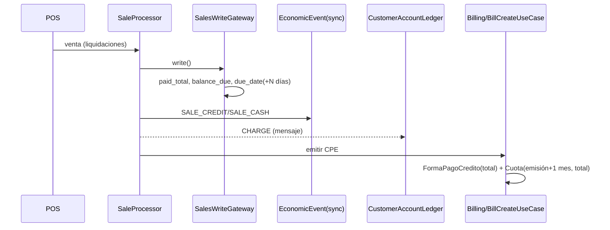

# 01 · Estado actual (AS-IS)

Todo lo marcado **[V]** fue leído en código el 2026-11-27. Rutas relativas a `nubit-erp/nubit-erp/`.

## 1. Arquitectura

- Monolito modular Symfony 7.4 / API Platform / Doctrine, MariaDB **base por tenant** (ADR-001, ADR-007). Frontend React en `assets/features/*`. Layout pragmático por contexto (ADR-006); ADR-002 está superseded.
- Excepción documentada a eventos: `Billing/Sales/Inventory/CashRegister` se llaman síncronamente en la ruta venta→stock→CPE→caja.
- Aislamiento multi-tenant: por base de datos, por lo que las tablas financieras **no llevan `tenant_id`** [V: no aparece en entidades revisadas]. El aislamiento entre tenants depende de `TenantConnection`; no se auditó. Aislamiento por sucursal: `branch_id` presente en `sale_record`, `supplier_bill`, `cash_register`; en `customer_account_entries` solo se pobla para anticipos (migración `20261126110000`).
- Contextos relevantes: `Sales` (158 archivos), `AccountsPayable` (23), `Treasury` (49), `CashRegister` (54), `Purchasing` (30), `Billing` (176), `BankReconciliation` (28), `Accounting` (13), `Reporting` (48).

## 2. Modelo de datos financiero

Tablas y su rol:

| Tabla | Rol | Notas verificadas |
| --- | --- | --- |
| `sale_record` | Venta; **también** contiene deuda (`balance_due`, `paid_total`, `due_date`, `receivable_account`) | Un único vencimiento. `version_no` manual, sin `@ORM\Version`. |
| `sale_payments` | Pago de una venta, FK dura a una venta | Se usa tanto para pagos del POS al vender como para cada aplicación de una cobranza (una fila por venta saldada). `idempotency_key` solo lo usa el flujo externo. |
| `customer_account_entries` | Ledger de cuenta corriente (CHARGE, PAYMENT, ADVANCE, CHARGE_REVERSAL) con `running_balance` | Índices no únicos `(customer_id,id)`, `(sale_id)`. Sin unicidad `(source, source_id)`. |
| `customer_payment_applications` | N:M entrada↔venta | `sale_id` es string sin FK; FK a la entrada con `ON DELETE CASCADE`. Sin unicidad. No hay estado/reversión. |
| `supplier_bill` / `supplier_payment` | Obligación y pago AP | `paid_total/balance_due/status` mutables; pago con `reversed_at`. |
| `treasury_account` / `treasury_movement` | Cuentas de dinero y ledger | Único `(source_type, source_id, leg)`, `CHECK signed_amount <> 0`. |
| `cash_sessions` / `cash_movements` | Turno y ledger de caja | Los cajones permanecen aquí (D-A del PRD de Treasury). |
| `collection_reminders` | Recordatorios | No son promesas de pago. |

No existen tablas de cuotas, promesas, límites de crédito, órdenes de pago, anticipos a proveedores ni compensaciones [V: grep de `installment|cuota|creditLimit` solo devuelve Billing/SUNAT, demo seeders y `TenantSettings`].

## 3. Flujos de extremo a extremo

### 3.1 Venta al contado / crédito (POS y Ventas)

`SaleProcessor` → `SalesWriteGateway::write()` (líneas ~100-190): calcula `paidTotal` (liquidaciones no-receivable) y `balanceDue` (liquidaciones tipo RECEIVABLE), `creditSale = balanceDue>0`, `formaPago = 2` si hay saldo, y `dueDate = issuedDate + defaultPaymentTermDays` (parámetro del tenant, único). Emite `EconomicEvent` `SALE_CREDIT`/`SALE_CASH`. Un mensaje (`RecordCustomerChargeOnSaleConfirmed`) agrega el CHARGE al ledger.

### 3.2 Cobranza global ("a cuenta")

`CollectOnAccountProcessor` (permiso `sales.collect`, `Idempotency-Key` opcional → `collectionId`) → `CollectOnAccountService::collect()`:

1. Replay: busca `findCollectionApplications($collectionId)` **antes** de la transacción.
2. Valida método COLLECTED, monto > 0.
3. `findOpenReceivablesForCustomer()` (sin lock) → `CollectOnAccountPlanner::fifo()` (orden `issued_date, issued_at, id`; **no** por vencimiento) o `explicit()`.
4. `assertFullyApplied`: si el monto excede la deuda, error 422.
5. Efectivo: exige caja abierta del usuario; moneda = la de la primera venta del plan.
6. `wrapInTransaction`: lock de la sesión de caja, movimiento de caja único, `applyPlan` (una entrada PAYMENT del ledger + por venta: `sale_payments` + `customer_payment_applications`), `TreasuryReceipts::record` (una vez), `EconomicEvent` único.

### 3.3 Cobro de una sola venta

`SalePaymentService::registerPayment()`: mismo esquema, una entrada de ledger y una aplicación por pago; Treasury con `sourceId = payment id`. Valida el saldo contra la entidad cargada.

### 3.4 Anticipos

`ReceiveAdvanceService::receive()` (ledger ADVANCE, caja/Treasury, `CUSTOMER_ADVANCE_RECEIVED_*` Dr Caja Cr 122). `ApplyAdvanceService::apply()`: `availableAdvance` leído sin lock; crea `sale_payments` con método interno inactivo "Anticipo aplicado" (creado perezosamente), aplicaciones FIFO sobre entradas ADVANCE, evento Dr 122 / Cr 121; `applicationId = Uuid::v4()` por llamada.

### 3.5 Cobro externo (API/integraciones)

`ExternalBankCollection`: `find(..., PESSIMISTIC_WRITE)` sobre la venta, clave determinista `Uuid::v5(client, referencia)`, replay solo si coincide exactamente, si no 409; crea `sale_payments` + ledger; Treasury cuenta banco o "clearing" (pasarela, `SettleGateway` liquida después). **Es el patrón correcto** y el único con lock.

### 3.6 Anulación de venta

`SaleVoidUseCase`: rechaza si hay pagos aplicados (`SaleException::hasAppliedPayments`), revierte pagos no-efectivo en Treasury (`TreasuryRefunds`) y registra `CHARGE_REVERSAL` (`ReceivableVoidReverser`).

### 3.7 Nota de crédito

`CreditNoteService`/`CreditNoteIssueController`/`NoteCreateUseCase`: emiten el comprobante SUNAT y reponen stock (`CreditNoteStockReverser`). **No** modifican `balance_due`, ledger, Treasury ni emiten `EconomicEvent` [V por grep de `balance|paidTotal|Treasury|refund|EconomicEvent` en esos tres archivos: sin coincidencias].

### 3.8 Compras y pagos a proveedores

`PurchaseProcessor`: persiste la compra, registra stock, emite `EconomicEvent PURCHASE` (total e IGV). No hay condición de pago ni creación de obligación. `SupplierBillCreateProcessor` crea la factura (manual, `purchase` opcional) y solo emite `SUPPLIER_BILL` si **no** tiene compra (evita doble devengo). `SupplierPaymentService::registerPayment()`: un pago a una factura; valida saldo sobre la entidad; actualiza `paid_total/balance_due/status`; registra en Treasury (efectivo exige caja abierta; si no, cuenta mapeada); `EconomicEvent`. `reversePayment()`: restaura saldos, marca `reversed_at`, reversión en Treasury, evento de reversión. API Platform: `PATCH /supplier-bills/{id}` con permiso `accounts_payable.create`; `amount` está en el grupo `supplier_bill:write`.

### 3.9 Tesorería

`RecordsMoneyMovement::record()` (`TreasuryMovementRecorder`): resuelve cuenta (efectivo → sesión del usuario; otros → override o mapeo por sucursal+método+moneda; si no hay, cuenta *suspense* con warning); rechaza moneda distinta a la de la cuenta; cuenta de tipo caja se delega a `DrawerRecorder` (`cash_movements`); resto a `treasury_movement` con inserción idempotente por clave. Gated por capability `treasury.accounts` (`TreasuryEnabledRecorder`). Cubre pagos de venta no-efectivo, cobranzas, anticipos, pagos a proveedores, nómina, transferencias; **no** repara histórico de cobranzas/anticipos/nómina (PRD Treasury §4).

## 4. Pantallas (frontend `assets/features`)

| Ruta | Código | Patrón |
| --- | --- | --- |
| `/accounts-receivable` | `sales/AccountsReceivablePage`, `CustomerReceivablesGrid`, `CustomerReceivableDetailView`, `CollectPaymentDialog`, `CustomerAdvanceDialog`, `receivableAging.ts` | Compuesta (rediseño #508/#509): agrupada por cliente, drawer. |
| `/accounts-payable` | `accountsPayable/SupplierBillPage`, `SupplierBillsGrid`, `SupplierBillPay`, `…Summary`, `…Forecast` | Aún sobre `SchemaCrudPage`, pago por factura en página propia. |
| Caja y bancos / Resumen | `treasury/`, `cashRegister/` | Resumen financiero (`FinanceSummaryQuery`), cuentas, transferencias. |
| Conciliación | `bankReconciliation/` | Fuente única Treasury cuando está activo. |

El ADR-021 documenta además problemas de UI (título, layout de error, vistas) que no se re-verificaron aquí.

## 5. Reportes

Estado de cuenta (`Sales/Report/CustomerStatement/*`): movimientos del ledger + cargos abiertos; aging por antigüedad **desde emisión** con `balance_due` **actual**. AP: `PayablesAgingCalculator` (PHP), forecast y summary por SQL. Aging existe tres veces (SQL en `CustomerReceivableProvider`, PHP en AP, TS en `receivableAging.ts`) [ADR-021 F3; el de statement es un cuarto cálculo con otra regla]. Flujo de caja desde Treasury si está activo; P&L desde GL si Contabilidad está activa.

## 6. Transacciones, concurrencia, auditoría

- Transacciones: `wrapInTransaction` en todos los flujos de dinero; el `EconomicEvent` va `sync` en la misma transacción.
- Locks: `FOR UPDATE` sobre `cash_sessions` y `treasury_account` (gateway), `PESSIMISTIC_WRITE` en `ExternalBankCollection`. **Ninguno** sobre `sale_record`, `supplier_bill` ni la cuenta corriente del cliente en los flujos internos.
- Auditoría: `OperationLog::record` en cobros; `created_by` en movimientos; log de actividad general. Sin cierre de periodos (grep de `period.?clos` solo en Payroll).

## 7. Fuentes de verdad actuales

| Hecho | Fuente(s) | Problema |
| --- | --- | --- |
| Saldo de factura de cliente | `sale_record.balance_due` (mutable) = total − Σ`sale_payments` | Copia en ledger y aplicaciones |
| Saldo del cliente | `customer_account_entries.running_balance` | Calculado con lectura-luego-inserción sin lock |
| Saldo de factura de proveedor | `supplier_bill.balance_due` (mutable) | Sin ledger |
| Dinero en cuentas | `treasury_movement` + `cash_movements` | Dual por diseño (D-A); opcional |
| Vencimiento | `sale_record.due_date` / `supplier_bill.due_date` / cuota SUNAT en XML | Tres valores posiblemente distintos |

## 8. Pruebas existentes

PHPUnit/Pest: `tests/Sales` (Service, State, Report, Security…), `tests/AccountsPayable`, `tests/Treasury` (recorder, backfill, transferencias, activación, `ExternalBankReceiptTest`), `tests/Architecture`. E2E Playwright: `accounts-receivable`, `accounts-payable`, `receivable-collection-statement`, `pos-credit-sale`, `credit-note-issue`, `treasury`, `cash-credit-reconciliation`. **No hay pruebas de concurrencia** en Sales/AP/Treasury (la búsqueda de `concurren|parallel|race` solo encuentra tests de idempotencia/demo).
