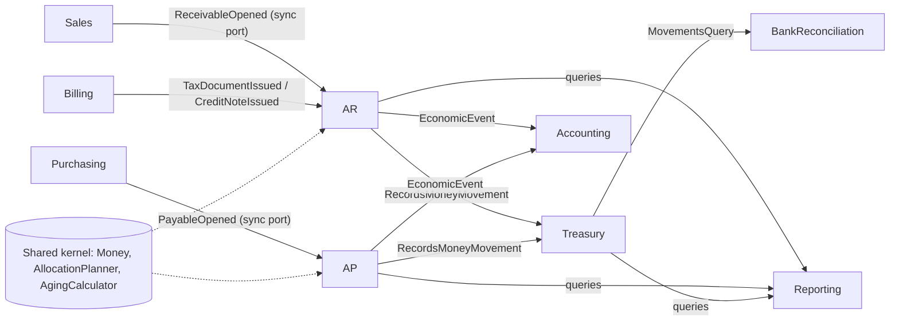
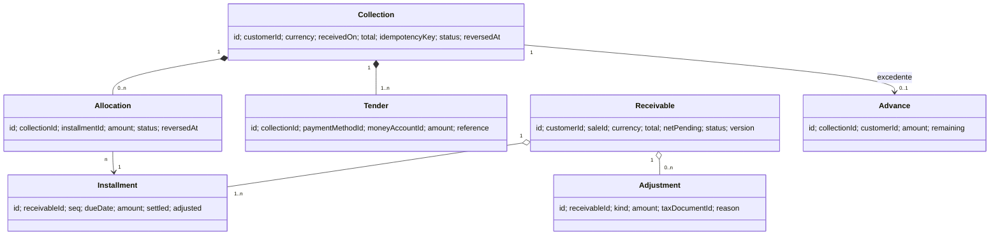
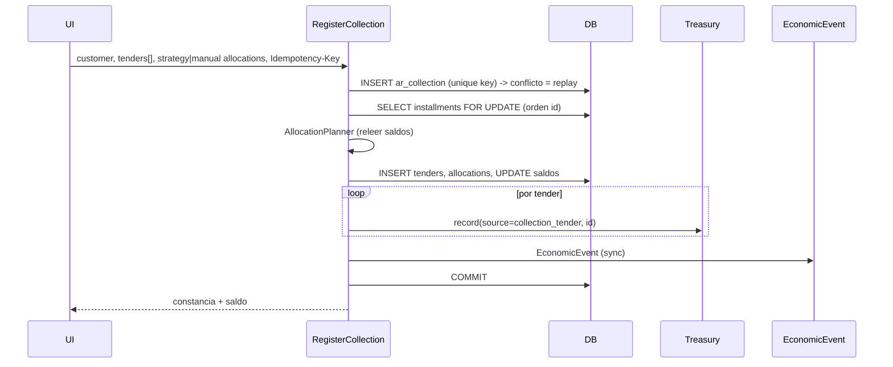

# 03 · Arquitectura objetivo (TO-BE)

Principio rector: **cerrar los huecos con el menor número de conceptos nuevos**, reutilizando lo que ya funciona (Treasury, `customer_payment_applications`, `EconomicEvent`, patrón de `ExternalBankCollection`). Tablas nuevas siguen la convención `<context>_*` (ADR-018, `NewTableNamingConventionTest`).

## 1. Context map



- **AR** y **AP** son *contextos conceptuales*. Fase 0–2: AR vive en `src/Sales` (namespace `Sales\Receivable`) y AP en `src/AccountsPayable`, para no reubicar 150 archivos. Extraer AR a `src/Receivables` es la decisión D-03, a tomar cuando haya un segundo consumidor (ADR-006: no abstraer antes).
- Shared kernel mínimo en `src/Efact/Domain/Finance` (donde ya vive `Money`): `AllocationPlanner` (puro, generaliza `CollectOnAccountPlanner`), `AgingCalculator` (único), `AllocationStrategy` (oldest-due, FIFO-issue, manual).

## 2. Reparto de responsabilidades y fuente de verdad

| Hecho | Contexto dueño | Fuente de verdad objetivo |
| --- | --- | --- |
| Operación comercial (venta/compra) | Sales / Purchasing | `sale_record` / `purchase` |
| Comprobante tributario y su aceptación | Billing | `tax_documents` |
| Derecho de cobro y cronograma | AR | `ar_installment` (origen: venta) |
| Obligación de pago y cronograma | AP | `ap_installment` (origen: factura de proveedor) |
| Cobranza (dinero recibido) | AR | `ar_collection` + `ar_collection_tender` |
| Aplicación financiera | AR / AP | `ar_allocation` / `ap_allocation` |
| Ajustes (NC/ND/castigo) | AR / AP | `ar_adjustment` / `ap_adjustment` |
| Movimiento de dinero | Treasury | `treasury_movement` / `cash_movements` |
| Conciliación | BankReconciliation | `bank_reconciliation_match` |
| Contabilidad | Accounting | `EconomicEvent` → GL (sin cambios) |

Reglas: una venta no escribe tablas de AR (usa el puerto); AR no escribe Treasury sino vía `RecordsMoneyMovement`; el saldo de una cuota es **derivable** de sus asignaciones y ajustes.

## 3. Modelo AR (espejo en AP)



### Agregados y límites transaccionales

1. **Receivable** (raíz; instalments como entidades hijas, saldo cacheado). Transacción: abrir/ajustar. Lock: fila `ar_receivable`.
2. **Collection** (raíz; tenders y allocations hijos). Transacción única: validar y bloquear las cuotas destino (orden por id), recalcular el plan, insertar cabecera con `idempotency_key` único, tenders, allocations, actualizar saldos de cuotas/receivable, llamar a Treasury por tender, emitir `EconomicEvent` por la cobranza, escribir auditoría. Es **una** transacción de BD (monolito).
3. **Advance** es un saldo a favor del cliente originado por una Collection (sin destino) o por una NC pagada; su consumo es una `Allocation` con `source = advance`, sin movimiento de tesorería (inv. 5 y §5.6).

Value objects: `Money` (existente), `Currency`, `InstallmentRef`, `AllocationPlan`, `IdempotencyKey`, `DocumentRef`.

### Invariantes (aplicadas en dominio **y** en BD cuando es posible)

| # | Invariante | Mecanismo |
| --- | --- | --- |
| I1 | Σ allocations activas de una cuota ≤ monto − ajustes | lock + `CHECK settled + adjusted <= amount` |
| I2 | Σ allocations + exceso = Σ tenders | validación de dominio; `CHECK` en cabecera (total) |
| I3 | Un anticipo no se usa dos veces | `remaining >= 0` con lock del anticipo |
| I4 | Cobranza idempotente | `UNIQUE(idempotency_key)` |
| I5 | Cuota, cobranza y asignación jamás se borran | sin DELETE; estado + `reversed_at` |
| I6 | Reversión = marcar y contra-movimiento, no borrar | `ReverseCollection` |
| I7 | Moneda homogénea cobranza/cuota | validación + `CHECK` currency |
| I8 | Σ cuotas = `net_pending` de la obligación | validación al abrir |
| I9 | Saldos reconstruibles a fecha | `allocation.applied_on`, `adjustment.occurred_on`, sin editar |

### Estados (dimensiones separadas)

| Dimensión | Persistir / calcular | Valores |
| --- | --- | --- |
| Comercial | persistido en `sale_record.status` (ya existe) | COMPLETED, VOIDED |
| Tributario | persistido en `tax_documents` | emitido/aceptado/rechazado/anulado |
| Liquidación | **calculado** desde saldos | open, partial, settled |
| Vencimiento | **calculado** (fecha de corte vs. `due_date`) | current, overdue(bucket) |
| Gestión de cobranza | persistido (Fase 2–3) | none, promised, in_dispute, written_off |
| Cobranza (header) | persistido | confirmed, reversed |
| Allocation | persistido | active, reversed |
| Conciliación | en Treasury/BankReconciliation | pending, matched |

Máquinas de estado: `Collection: confirmed → reversed` (final); `Allocation: active → reversed`; `Adjustment: applied → reversed`; `Receivable.management: none ↔ promised ↔ in_dispute → written_off`. Una cobranza `reversed` no se vuelve a abrir; se registra una nueva.

### Estrategia de saldo

Se mantiene `balance_due` como **caché** (rendimiento de la lista de cartera) en `ar_receivable`/`ar_installment`, actualizado bajo el lock en la misma transacción, y verificado por `finance:verify`. Los reportes a fecha de corte **no** usan la caché: suman allocations/adjustments con fecha ≤ corte. `sale_record.balance_due` pasa a ser una columna de compatibilidad escrita desde AR (ver `05`).

## 4. ¿Subledger / movimientos inmutables?

Sí, pero **ya casi existe**: `customer_account_entries` (ledger AR) + `treasury_movement`. Decisión: el ledger de cuenta corriente se convierte en **proyección derivada** de collections/receivables/adjustments (se puede recomputar con ventana `SUM() OVER`), eliminando `running_balance` persistido y la carrera G-03. Para AP se crea el equivalente solo cuando haga falta el estado de cuenta de proveedor (Fase 1, vista SQL sobre `ap_*`; sin tabla de ledger propia al inicio). **Descartado:** Event Sourcing, CQRS, motor de workflows, doble partida nueva (no hay necesidad demostrada; Accounting ya consume `EconomicEvent`).

## 5. AR vs AP: ¿compartir?

Compartir **primitivas**: planner, aging, `Money`, `IdempotencyKey`, patrón de lock y verificación. Mantener **modelos separados** (`ar_*`, `ap_*`): sus ciclos difieren (crédito/mora/promesas vs. programación/orden/autorización) y una tabla `obligation` genérica obligaría a columnas nulas o flags por lado. Costo aceptado: dos juegos de tablas casi simétricos. Alternativa descartada: `finance_obligation(side)` único.

## 6. Casos de uso (capa de aplicación)

AR: `OpenReceivable`, `RegisterCollection` (global/por documento/multi-medio/exceso), `ReverseCollection`, `ReceiveAdvance`, `ApplyAdvance`, `ApplyAdjustment` (NC/ND), `RefundCustomer`, `WriteOffReceivable`, `RegisterPaymentPromise`, `SetCreditPolicy`, `GetStatement(asOf)`, `GetAging(asOf)`.
AP: `OpenPayable` (desde compra o factura directa), `RegisterPayment` (global/por documento), `ReversePayment`, `PayAdvance`, `ApplyAdvance`, `ApplySupplierCreditNote`, `SchedulePayment`, `CreatePaymentOrder`, `AuthorizePayment` (fase 3).

Los controladores solo llaman a estos casos de uso; el planner y los guardas son servicios de dominio puros.

## 7. Contratos entre contextos

```php
interface OpensReceivable { function open(ReceivableDraft $d): ReceivableRef; }   // Sales → AR (sync)
interface AppliesAdjustment { function apply(AdjustmentRequest $r): AdjustmentRef; } // Billing → AR (sync, misma tx que la NC)
interface RecordsMoneyMovement { /* existente, sin cambios */ }
```

Eventos (Messenger, tras commit salvo los marcados): `CollectionRegistered`, `CollectionReversed`, `ReceivableOpened`, `AdjustmentApplied`, `PaymentRegistered`, `PaymentReversed`, `PayableOpened`; los suscriptores son proyecciones y notificaciones, **no** reglas de integridad. `EconomicEvent` sigue síncrono.

## 8. Secuencia: cobranza global con multi-medio y exceso



Ejemplo del encargo (A800, B1200, C2400, D1400, abono 2500): 1 cobranza, 3 allocations (800/1200/500), A y B `settled`, C `partial` (1900), D sin cambios, saldo 3300. Los tenders (1000 efectivo + 1500 transferencia) son independientes de las allocations.

## 9. Decisiones arquitectónicas

| ADR propuesto | Decisión | Alternativas descartadas |
| --- | --- | --- |
| A-1 | Cabecera `collection` + `tender` + `allocation` | Seguir con `sale_payments` por aplicación (sin multi-medio, mezcla pago de venta y cobro) |
| A-2 | Cuotas como entidad propia | Columnas `due_date` extra / JSON de cuotas en la venta |
| A-3 | Saldo cacheado + verificado, histórico por suma | Solo saldo derivado (listas lentas); solo saldo mutable (lo actual) |
| A-4 | Lock pesimista sobre filas destino + `idempotency_key` único | `@ORM\Version` optimista con reintento (aceptable para ediciones, no para un cobro que ya movió caja) |
| A-5 | Modelos AR/AP separados con kernel compartido | `obligation` genérica |
| A-6 | Treasury se mantiene (D-A del PRD) | Espejo de cajones en `treasury_movement` |
| A-7 | Ledger de cliente como proyección | Mantener `running_balance` persistido con lock |
| A-8 | Ajustes (`adjustment`) para NC/ND/castigo | Modificar `balance_due` directamente desde Billing |

## 10. Consultas y reporting

Lecturas desde `ar_*`/`ap_*` + Treasury; aging y estado de cuenta en un solo servicio backend con parámetro `asOf`; los frontends solo renderizan. Reportes de flujo proyectado: cuotas pendientes por `due_date` + cuotas AP programadas.
