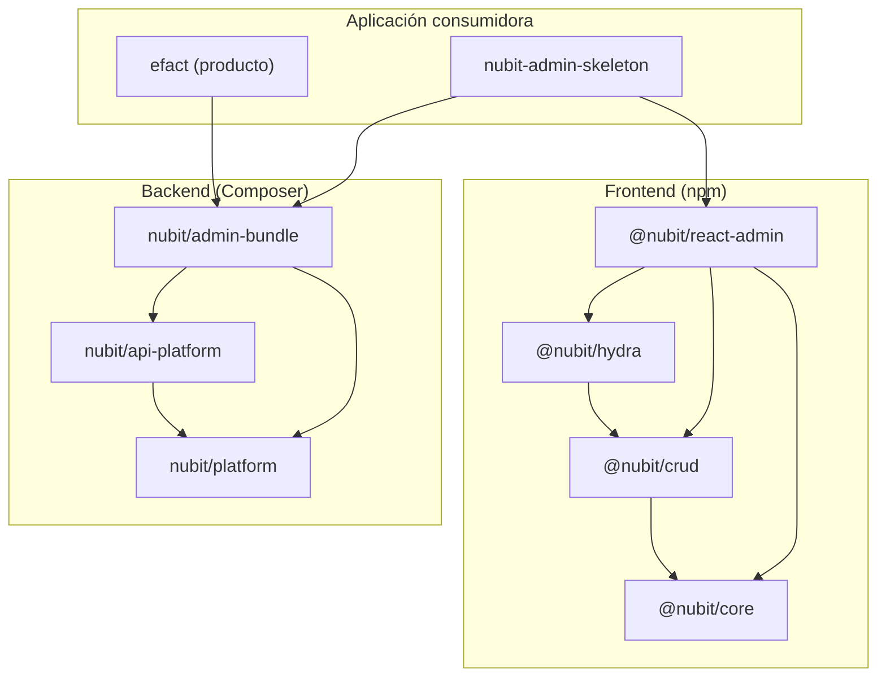

# Plan de extracción backend Nubit

Documento de diseño acordado para publicar el stack CRUD de efact como librerías PHP reutilizables, alineadas con los paquetes npm `@nubit/*`.

**Estado:** aprobado para implementación (big bang)  
**Última revisión:** 2026-06-05

---

## 1. Resumen ejecutivo

El backend portable vive hoy en tres capas dentro del monolito:

| Capa actual | Namespace / ruta | Rol |
|-------------|-------------------|-----|
| Plataforma | `Nubit\Platform\` → `src/Platform/` | Contratos, excepciones, tenant context, features, infra compartida |
| Bridge CRUD | `App\Efact\` → `src/Efact/` | Contrato API Platform ↔ `@nubit/hydra` (grid, `x-crud`, paginación) |
| Producto | `App\{ControlPlane,Identity,Billing,...}\` | SaaS, dominio Perú, auth de producción |

**Objetivo v1:** monorepo `packages/` con tres publicables MIT + skeleton full-stack. El consumidor principal instala **un solo bundle** (`nubit/admin-bundle`), al estilo EasyAdmin, no tres paquetes a mano.

**Migración en efact:** big bang (un PR que mueve código, actualiza Composer y elimina duplicados).

**Tenant en v1 del starter:** single-tenant; multi-tenant real sigue en ControlPlane de efact.

---

## 2. Problema que resolvemos

Otros proyectos (web + Android) necesitan:

1. API REST/Hydra con filtros de grid compatibles con `@nubit/crud`.
2. OpenAPI con hints `x-crud` para `@nubit/hydra`.
3. Auth alineada con `@nubit/core` (cookies en web, Bearer en móvil).
4. Arranque en horas, no semanas de copiar `DataGridFilter` y listeners desde efact.

La extracción no es “sacar `src/Platform`” sola: sin el bridge API Platform, el frontend Nubit no genera pantallas CRUD útiles.

---

## 3. Decisiones de diseño (acordadas)

| # | Tema | Decisión |
|---|------|----------|
| 1 | Alcance v1 | Stack completo: platform + api-platform + bundle + skeleton (opción C original) |
| 2 | Multi-tenant en starter | **Single-tenant**; implementaciones noop de contratos `Nubit\Platform\Tenant\*` |
| 3 | Repositorio | **Monorepo** `packages/` dentro de efact; publicación Packagist después |
| 4 | Auth | **Cookie + Bearer** — un `JWTAuthenticator`; login con `response_mode: cookie \| json` |
| 5 | Nombres Composer | `nubit/platform`, `nubit/api-platform`, `nubit/admin-bundle` |
| 6 | DX consumidor | **Un bundle** como entrada (`composer require nubit/admin-bundle`) |
| 7 | Onboarding | **Skeleton primero**; el template ya incluye el bundle |
| 8 | Skeleton | **Full-stack** (Symfony + Vite/React + `@nubit/react-admin` + entidad ejemplo) |
| 9 | Migración efact | **Big bang** — un PR grande, CI verde antes de merge |
| 10 | Licencia paquetes | **MIT** (app efact puede seguir proprietary en raíz) |
| 11 | Mercure | **Off por defecto en bundle**; **on en skeleton** (compose + entidad ejemplo) |
| 12 | Identity | **Dentro de `admin-bundle`** (no paquete separado en v1) |

---

## 4. Arquitectura de paquetes



### 4.1 `nubit/platform`

**Origen:** `src/Platform/` (ya namespace `Nubit\Platform\`).

**Contenido:**

- Excepciones de dominio (`ServiceException`, `ValidationException`, `DomainProblemException`, …).
- `TenantContext` y contratos (`TenantRegistryInterface`, `TenantConnectionSwitcherInterface`, …).
- Feature gates (`RequiresFeature`, `FeatureCheckerInterface`).
- Quota contracts.
- Messenger: `TenantStampMiddleware`, `TenantContextMiddleware`.
- Infra: `CacheManager`, `FileManager`, export/report helpers, `TenantRateLimiter`.
- `PerTenantCommand` para consolas multi-tenant (usado por efact; noop/stub en starter).

**No incluye:** API Platform, Doctrine filters, JWT, entidades de negocio.

**Guard de frontera:** `scripts/architecture/check-platform-boundary.php` (SPEC-004) — debe seguir pasando en CI.

### 4.2 `nubit/api-platform`

**Origen:** piezas de `src/Efact/` que definen el contrato con el frontend.

| Componente actual | Responsabilidad |
|-------------------|-----------------|
| `Efact\Doctrine\Filter\DataGridFilter` | Query params `sort`, `filter`, `searchValue` del grid |
| `Efact\ApiPlatform\TranslatedDocumentationNormalizer` | Traduce labels + reenvía `x-crud` a Hydra docs |
| `Efact\Http\ApiResponseListener` | Headers `X-Total-Count`, `X-Total-Pages`, `X-Current-Page` |
| Traits / `AuditableEntity` (si aplica) | Convenciones de entidad reutilizables |

**Dependencias:** `nubit/platform`, `api-platform/core`, Doctrine, Symfony Serializer/Translation.

**Convención de entidad** (documentar en README del paquete):

```php
#[ApiResource(
    operations: [new GetCollection(), new Post(), new Get(), new Patch(), new Delete()],
    filters: [DataGridFilter::class],
    mercure: true, // opcional
)]
#[ApiProperty(
    description: 'product.name.label', // clave i18n
    openapiContext: ['x-crud' => ['filterable' => true, 'sortable' => true, 'order' => 0]],
)]
```

### 4.3 `nubit/admin-bundle`

**Rol:** única dependencia Composer que pide el 80% de consumidores (patrón EasyAdmin).

**Depende de:** `nubit/platform`, `nubit/api-platform`, API Platform, Security, JWT (firebase/php-jwt o equivalente ya usado en efact).

**Registra automáticamente:**

- Servicios de `api-platform` (filtro, normalizer, listener).
- Extension Symfony `NubitAdminExtension` + `config/packages/nubit_admin.yaml`.
- Rutas auth: `/api/auth/login`, `/api/auth/refresh`, `/api/auth/logout`.
- Security: firewall stateless `/api`, `JWTAuthenticator` dual.
- Bindings single-tenant por defecto (registry/conexión noop).
- Parámetros: `nubit.admin.mercure.enabled` (default `false`).

**Identity v1 (incluida en el bundle):**

- Entidades/interfaces mínimas o migraciones opcionales documentadas.
- Lógica adaptada desde `App\Identity` (login, refresh, cookies, JWT).

**efact post-migración:** el bundle se registra, pero **override** de bindings hacia ControlPlane (`TenantManager`, `TenantFeatureChecker`, etc.) en `config/services.yaml` de la app.

### 4.4 Skeleton `nubit-admin-skeleton`

**No es un paquete Composer runtime obligatorio.** Es plantilla de proyecto (carpeta `skeleton/` o repositorio template Git).

**Incluye:**

- App Symfony que solo requiere `nubit/admin-bundle`.
- `docker-compose`: MariaDB/PostgreSQL + Mercure (**Mercure on**).
- Entidades ejemplo: `User`, `Role`, `Product` con `DataGridFilter` + `x-crud`.
- Frontend Vite: `@nubit/react-admin`, una página `SmartCrudPage`, `CoreProvider` con cookie auth.
- `.env` y README: web vs Android.

---

## 5. Contrato API ↔ frontend

Este contrato ya existe en efact; los paquetes lo formalizan.

| Aspecto | Backend | Frontend |
|---------|---------|----------|
| Documentación | `/api/docs.jsonld` con `x-crud` en `hydra:supportedProperty` | `@nubit/hydra` → `mapHydraSchemaToFields` |
| Colección Hydra | `hydra:member`, `hydra:totalItems` | `HydraRemoteDataSource` |
| Paginación alternativa | Header `X-Total-Count` | Mismo data source |
| Filtros grid | `sort`, `filter`, `searchValue` | Serialización en `CoreHttpClient` / load options |
| Errores dominio | `Nubit\Platform\Exception\ServiceException` → 422 | `CoreHttpClient` + violations |
| Tiempo real | Mercure en `ApiResource` (opcional) | `useMercureSubscription` en `SmartCrudPage` |
| IDs Hydra | `@id` / IRIs | `HydraAdapter` en `@nubit/crud` |

---

## 6. Autenticación dual (web + Android)

### 6.1 Un authenticator

`JWTAuthenticator` acepta, en orden:

1. Header `Authorization: Bearer <token>` si está presente.
2. Si no, cookie HttpOnly de access token (nombre alineado con efact).

### 6.2 Login

`POST /api/auth/login`

| Campo | Valores |
|-------|---------|
| `response_mode` | `cookie` (default web) \| `json` (móvil) |
| credenciales | `username`, `password` |

**`response_mode: cookie`**

- Set-Cookie access + refresh HttpOnly.
- Cuerpo opcional mínimo (usuario/perfil).
- Compatible con `CoreProvider` (`autoRefresh: true`, `refreshPath: auth/refresh`).

**`response_mode: json`**

- Cuerpo `{ "accessToken", "refreshToken", "expiresIn", "user": { ... } }`.
- Sin cookies obligatorias.
- Cliente Android guarda tokens y envía Bearer.

### 6.3 Refresh

| Cliente | Método |
|---------|--------|
| Web | `POST /api/auth/refresh` con cookies (comportamiento actual `@nubit/core`) |
| Android | `POST /api/auth/refresh` con body `{ "refreshToken": "..." }` |

### 6.4 Documentación obligatoria en bundle

- Receta web: `CoreConfigProvider` + `CoreProvider` sin cambios.
- Receta Android: `autoRefresh: false`, `refreshFn` custom, header en cada request.

---

## 7. Single-tenant vs efact multi-tenant

| Contexto | Tenant registry | Connection switcher | Feature checker |
|----------|-----------------|---------------------|-----------------|
| Skeleton / app simple | Noop (un tenant fijo) | Noop (una DB) | Allow-all o checker noop |
| efact producción | `App\ControlPlane\Tenant\Service\TenantManager` | `TenantConnectionSwitcher` | `TenantFeatureChecker` |

El bundle registra implementaciones noop; efact las **reemplaza** en `services.yaml` (patrón ya usado en SPEC-004/005).

ControlPlane **no** se extrae en v1.

---

## 8. Estructura de directorios (objetivo)

```
efact/
├── packages/
│   ├── platform/
│   │   ├── composer.json          # nubit/platform
│   │   └── src/                   # Nubit\Platform\
│   ├── api-platform/
│   │   ├── composer.json          # nubit/api-platform
│   │   └── src/                   # Nubit\ApiPlatform\
│   └── admin-bundle/
│       ├── composer.json          # nubit/admin-bundle
│       ├── src/                   # Nubit\AdminBundle\
│       └── config/                # services, routes, schema
├── skeleton/
│   └── nubit-admin-skeleton/      # template full-stack
├── src/                           # dominio efact (sin bridge duplicado)
├── assets/                        # @nubit/* npm (plan frontend aparte)
└── docs/architecture/
    └── nubit-backend-extraction-plan.md  # este documento
```

**Composer raíz efact** (durante transición):

```json
{
  "repositories": [
    { "type": "path", "url": "packages/*", "options": { "symlink": true } }
  ],
  "require": {
    "nubit/platform": "@dev",
    "nubit/api-platform": "@dev",
    "nubit/admin-bundle": "@dev"
  }
}
```

---

## 9. Plan de migración big bang (efact)

### 9.1 Orden de trabajo en el PR

1. Crear `packages/platform` — mover `src/Platform` → eliminar carpeta vacía o README en `src/Platform`.
2. Crear `packages/api-platform` — mover bridge desde `Efact`; namespace `Nubit\ApiPlatform\`.
3. Crear `packages/admin-bundle` — Identity + wiring + `NubitAdminBundle`.
4. Actualizar `composer.json` raíz + `config/bundles.php` + `services.yaml` (overrides ControlPlane).
5. Buscar/reemplazar imports `App\Efact\{Doctrine\ApiPlatform,Http}\*` → `Nubit\ApiPlatform\*`.
6. Eliminar código muerto y aliases `App\Core\*` legacy cuando el bundle cubra el caso.
7. Añadir `skeleton/nubit-admin-skeleton` (puede ser PR follow-up si el PR ya es enorme — decidir en implementación).
8. CI verde.

### 9.2 Checklist de verificación

- [ ] `php scripts/architecture/check-platform-boundary.php`
- [ ] `composer install` + `bin/console lint:container`
- [ ] PHPUnit backend
- [ ] `GET /api/docs.jsonld` contiene `x-crud` en al menos un recurso
- [ ] Login `response_mode=cookie` + request autenticada con cookie
- [ ] Login `response_mode=json` + request con `Authorization: Bearer`
- [ ] Grid: `GET /api/products?sort[0][selector]=name` (o recurso equivalente) + header `X-Total-Count`
- [ ] `yarn test:unit` (frontend sin regresión)
- [ ] ControlPlane: quota/feature overrides siguen resolviendo

### 9.3 Riesgos del big bang

| Riesgo | Mitigación |
|--------|------------|
| PR imposible de revisar | Commits por paquete dentro del mismo PR; descripción con tabla de movimientos |
| Regresión auth | Tests funcionales login cookie + json |
| Servicios duplicados Symfony | `lint:container` + smoke boot |
| Imports rotos en dominio | CI GrumPHP / PHPStan |

---

## 10. Relación con frontend `@nubit/*`

| Paquete PHP | Paquete npm relacionado |
|-------------|-------------------------|
| `nubit/api-platform` | `@nubit/hydra`, `@nubit/crud` |
| `nubit/admin-bundle` | `@nubit/react-admin` (umbrella) |
| `nubit/platform` | `@nubit/core` (tipos/eventos; sin dependencia npm directa) |

El skeleton full-stack es el equivalente a instalar `@nubit/react-admin` + tema CSS en el mismo repo que el Symfony app.

Documentación frontend: `assets/crud/README.md`, `assets/core/README.md` — mantener enlaces cruzados a este plan.

---

## 11. Fuera de alcance v1

- Paquete `nubit/control-plane` (SaaS provisioning, planes, PayPal, etc.).
- Paquete `nubit/identity` separado (evaluar v1.1 si hay consumidores API-only).
- Multi-tenant en skeleton.
- Publicación Packagist obligatoria (puede ser v1.0.1; v1 desarrollo con `path` repos).
- Extracción de dominios efact (`Billing`, `Sales`, …).
- Cambios breaking en contrato OpenAPI sin versión major.

---

## 12. Fases posteriores (post big bang)

| Fase | Entregable |
|------|------------|
| v1.0.0 | Tags Packagist; efact deja `path` → `^1.0` |
| v1.1 | `nubit/identity` opcional; recipe Flex estable |
| v1.2 | Paquete opcional multi-tenant / documentación ControlPlane |
| Paralelo npm | Publicar `@nubit/*` (plan en `docs/architecture/` o issue dedicado) |

---

## 13. Criterios de terminado (v1 backend)

1. Tres paquetes en `packages/` con `composer.json` MIT y tests mínimos.
2. efact consume solo paquetes (sin bridge duplicado en `App\Efact` para grid/docs/headers).
3. `nubit/admin-bundle` instalable con una línea + config por defecto funcional.
4. Skeleton full-stack arranca con `docker compose up` + login web + página CRUD de ejemplo.
5. Documentación auth web/Android en README del bundle.
6. CI incluye boundary check + smoke auth/grid.

---

## 14. Referencias en el repo

| Recurso | Ruta |
|---------|------|
| Platform boundary guard | `scripts/architecture/check-platform-boundary.php` |
| Migración Core → Platform | `src/Core/README.md` |
| Bindings SPEC-004/005 | `config/services.yaml` |
| Excepciones API Platform | `config/packages/api_platform.yaml` |
| Entidad CRUD ejemplo | `src/Catalog/Entity/Category.php` |
| Frontend Hydra mapper | `assets/hydra/HydraToFieldMapper.ts` |
| PRD (multi-tenant efact) | `docs/PRD.md` |

---

## 15. Historial de decisiones

| Fecha | Evento |
|-------|--------|
| 2026-06-05 | Sesión `/grill-me`: acuerdo alcance C, bundle tipo EasyAdmin, skeleton full-stack, big bang, MIT, auth dual, Mercure C |