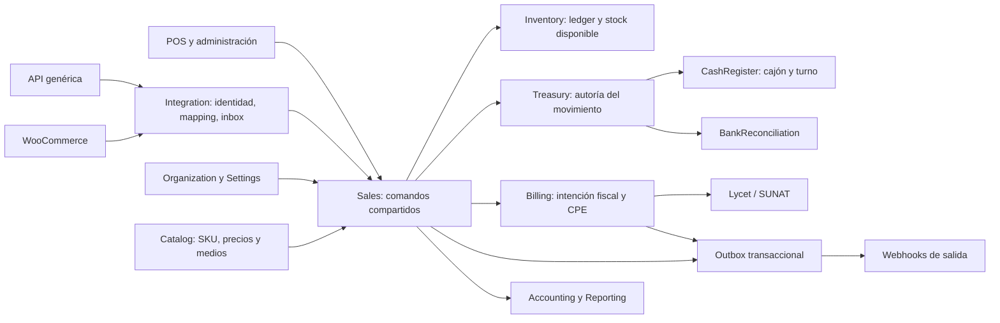
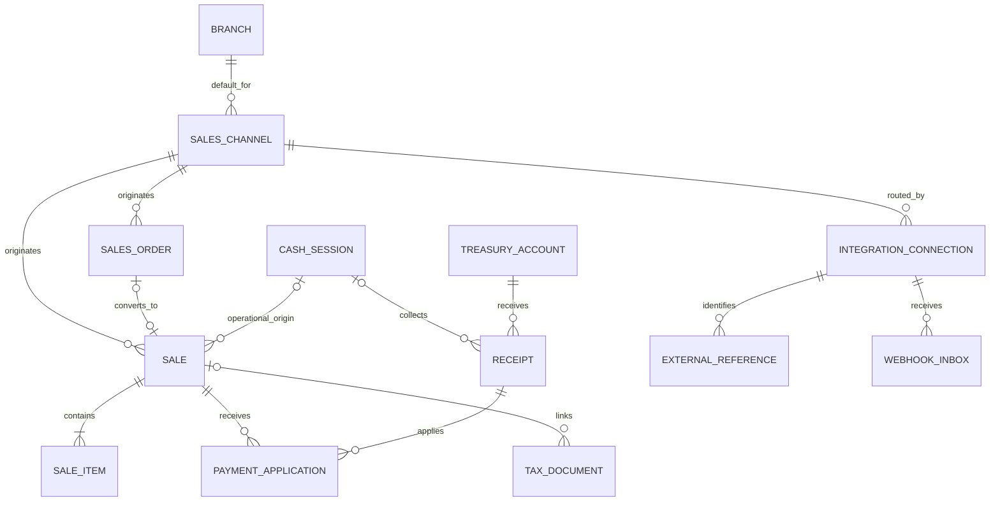
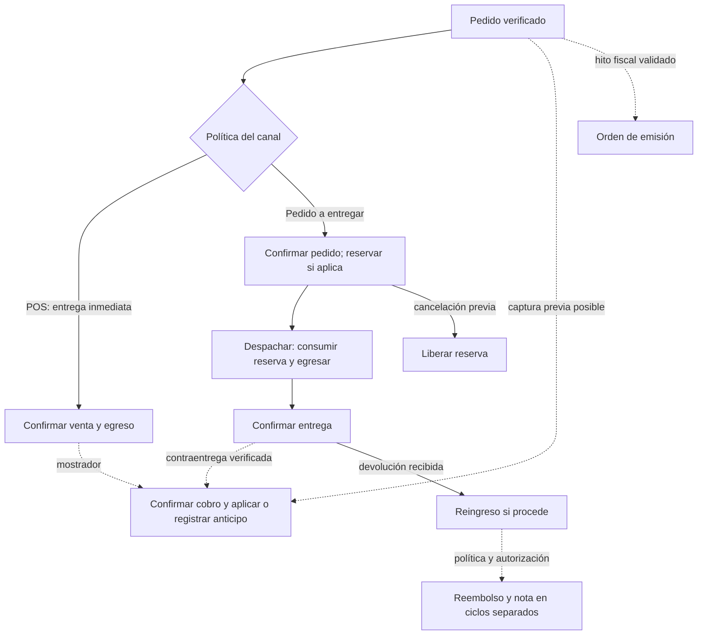
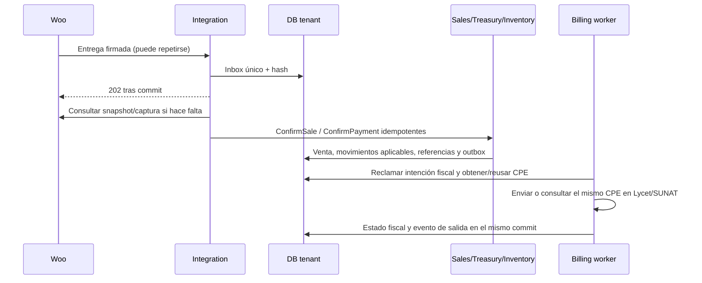

# Ventas multicanal — diagnóstico y plan para Nubit ERP

**Base:** revisión estática de `1a9ae4c0a` y del árbol de trabajo. No se modificó el repositorio, no se ejecutaron migraciones ni se midió cobertura. Las rutas de referencia son relativas a la raíz del repositorio. **Verificado** = código/esquema encontrado; **inferencia** = consecuencia a comprobar con pruebas/datos; **propuesta** = diseño no implementado; **pendiente** = decisión o evidencia faltante.

**Avance inicial:** el diagnóstico describe la línea base. La primera entrega de caja ejecuta el cierre en una transacción y bloquea la fila del turno antes de leer el ledger. Esto coordina el cierre con movimientos manuales y evita sobrescribir un Z ya persistido. Queda pendiente aplicar una política común a las escrituras POS, abonos y reembolsos, incluido el replay offline que llega después del cierre. Hay regresiones de unidad y MariaDB para el cierre; no se ejecutaron migraciones.

**Primer caso comercial sin caja:** `POST /api/sales/administrative-credit` es una operación interna JWT (`sales.create` y `sales.view`), no la API pública de integración. Usa el mismo procesamiento y la sucursal seleccionada, requiere almacén de esa sucursal y una única liquidación `RECEIVABLE` por el total. Deja caja, turno y pagos vacíos; mantiene vendedor humano, inventario y saldo por cobrar. No cambia `POST /api/sales` ni habilita órdenes, cobros externos o identidades de servicio.

**Atribución técnica:** `sales.integration_client_id` referencia al `ApiClient` de la misma base tenant. Una venta conserva un solo actor de origen: vendedor humano o cliente API sin caja/turno; las ventas históricas no se reasignan. `SalesWriteGateway::writeIntegrationCredit` es persistencia interna para crédito y no está expuesta. La autorización de sucursal, el procesamiento comercial y la idempotencia de la API técnica siguen pendientes. La migración debe desplegarse antes del código que lee la columna y el rollback de esquema se bloquea cuando ya hay ventas técnicas.

**Ingreso técnico protegido:** `SalesIntake` exige `sales:write`, tenant autenticado y sucursal activa asignada al cliente antes de reservar una clave de idempotencia. La clave es única por cliente; misma sucursal y mismo hash recuperan la venta; contenido o sucursal distintos devuelven conflicto. La reserva y los efectos comerciales locales deben compartir la conexión y la transacción. Provisionar clientes piloto con `app:integration:api-key:create --scope=sales:write --sales-branch=<id>` además de tenant y nombre. No se conceden permisos a clientes existentes por defecto. Falta conectar la confirmación comercial y exponer el endpoint.

**Primer corte de API comercial:** `POST /api/v1/sales` conecta ese ingreso a `ConfirmIntegrationCredit`. Es un piloto de crédito en PEN, con referencias y precios del ERP, saldo por cobrar y salida inmediata. Valida el stock disponible neto de reservas bajo bloqueo y agrupa la demanda por producto antes de descontar. No habilita cobros, emisión SUNAT, pedidos pendientes, ni corrige por sí solo las carreras de otros escritores de stock legados.

**Cobro bancario externo (interno):** `ExternalBankCollection` aplica una referencia de cobro confirmada a una venta del mismo cliente API y sucursal, sin caja. Bloquea la venta y confirma abono, aplicación, movimiento bancario y asiento juntos. Tesorería activa y mapeo bancario por medio/sucursal/moneda son obligatorios; no se usa suspenso. La referencia se deduplica por cliente API y una repetición se rechaza con conflicto. El adaptador aún debe verificar la captura con su proveedor antes de invocar esta operación. Pasarelas con fondos por liquidar, comisiones y endpoint público siguen pendientes.

**Consulta comercial:** `GET /api/v1/sales/{id}` exige `sales:read` y devuelve estado, moneda, total y saldo vigente para las ventas del cliente API en su sucursal activa. El saldo y el total conservan su representación decimal. La consulta devuelve `404` fuera de ese alcance.

## Resumen ejecutivo

**Propuesta:** mantener `SaleRecord` (`sales`) y profundizar el módulo de confirmación de ventas detrás de una interfaz común para POS, administración e integraciones. Conservar el turno de origen como dato histórico cuando exista; atribuir el cobro a su propio turno y el dinero a su cuenta o custodio real. Reutilizar Treasury, el ledger de clientes, Billing y el contexto Integration. No crear un segundo modelo de venta, una caja virtual ni usuarios ficticios.

**MVP recomendado:** una tienda WooCommerce piloto y un cliente API genérico por tenant; una sucursal y almacén configurados por canal, PEN, SKU explícitamente mapeado, venta confirmada y pago externo verificado, emisión por ERP según reglas validadas, egreso en la confirmación para el flujo piloto con entrega directa y trazabilidad en ventas y tesorería. Recibir pedidos todavía no elegibles sin convertirlos en ventas; no simular despacho ni declarar efectivo que el ERP no custodia. Si el piloto cobra antes de entregar o acepta contraentrega, activar ese escenario solo después de resolver stock, fiscalidad y custodia; o acotar el piloto a recojo/despacho controlado con tratamiento fiscal explícito. No habilitar automáticamente operaciones que queden fuera del perfil.

## 1. AS-IS: mapa de contexto y capacidades ya disponibles

**Verificado.** Monolito modular PHP/Symfony, API Platform, Doctrine/MariaDB y SPA React/TypeScript. Base por tenant y conexión separada para control plane. `architecture/contexts.yaml` y ADR-001/003/006/007/010/011/017/018/019/021 describen alcance y dependencias; los ADR históricos no sustituyen el código. `Sales` depende actualmente de `Inventory`, `Billing`, `CashRegister`, `Treasury`, `Accounting`, `Identity`, `Organization`, `Catalog` y otros; `Inventory` y `Billing` conocen a `Sales`. ADR-001 permite llamadas síncronas concretas en el camino crítico; no convertir el monolito en microservicios ni imponer un ORM compartido entre nuevos módulos.

| Contexto | Fuente y responsabilidad verificada |
|---|---|
| Sales | `src/Sales/Entity/SaleRecord.php`, `SaleItemRecord.php`, `SalePayment.php`, `SaleQuote.php`; `State/SaleProcessor.php`, `State/SalesWriteGateway.php`, `Service/SalePaymentService.php`; venta, líneas, liquidación comercial y CxC. |
| CashRegister | `src/CashRegister/` usa `cash_sessions`, `cash_movements` y `cash_reconciliations` en rutas vigentes; ADR-004 distingue el corte funcional del agregado DDD no implementado. |
| Inventory | `src/Inventory/Entity/Warehouse.php` relaciona almacén con `Branch`; `stock_movements` y `stock_items` son ledger y proyección vigente según ADR-010, no el espejo legado. |
| Billing | `src/Billing/` posee CPE, series, notas, guías y envíos SUNAT; Greenter como modelo, Lycet/Bill para envío (ADR-011). La guía electrónica (`Despatch/Entity/DespatchGuide.php`) no es por sí sola el ciclo de entrega de un pedido. |
| Organization/Settings/Catalog | `src/Organization/Entity/{Company,Branch}.php`, `src/Inventory/Entity/Warehouse.php`, `src/Catalog/Entity/PaymentMethod.php`, `Catalog/Enum/SettlementBehavior.php`; `TenantRuntimeConfig` y onboarding proveen defaults de sucursal, almacén y series. Establecimiento fiscal no debe inferirse del nombre de la sucursal. |
| Treasury/Accounting/BankReconciliation | Custodia, movimientos y conciliación, separados del reconocimiento contable. `config/packages/messenger.yaml` enruta `EconomicEvent` a `sync`; no asumir que cada ruta lo emite dentro de la misma transacción. |
| Identity/Integration | JWT humano y sucursal seleccionada; `ApiClient`/`ApiKey` machine-to-machine; DB por tenant; no existe en la API pública revisada un intake comercial equivalente al fiscal. |
| Reporting | `src/Sales/Report/{DetailedSalesReport,DailySummaryReport,PaymentMethodBreakdownReport}.php`, `SalesAnalyticsRepository`, `src/Reporting/{Ple,Sire,Financial,TeamControl}/`: separar ventas operativas, cobros, documentos fiscales y resultados contables. |

### Alternativas comerciales presentes

- `SaleQuoteConversionService::convert` crea directamente `SaleRecord` en `COMPLETED`, asigna vendedor, almacén/sucursal, saldo total, nota de venta y marca cotización convertida (`src/Sales/Service/SaleQuoteConversionService.php:64–149`). No llama `SaleProcessor` en ese método. No tratar conversión como pedido, ni dar por comprobado que dispare los mismos efectos laterales.
- `src/Billing/Recurring/Command/GenerateRecurringSalesCommand.php` es otra entrada; incluye `resolveSystemSellerId()`. Revisar su compatibilidad y no copiar atribución humana artificial al nuevo flujo.
- **Verificado en la superficie revisada:** no se encontró agregado genérico `SalesOrder` ni reserva/despacho comercial omnicanal; distinguir cotización, guía fiscal y operaciones verticales del nuevo caso de uso. La inexistencia se refiere a esa capacidad compartida, no a todas las variantes sectoriales.

### Traza real del POS: apertura → venta → stock → cobro → CPE → cierre

1. **Apertura.** `CashRegisterOpenProcessor` (`src/CashRegister/State/`, :60) valida caja/sucursal, escribe `cash_sessions` y movimiento de auditoría `OPENING` en un commit. El guard generado de `Version20260227180000_enterprise_guardrails.php:34` limita una sesión `OPEN` **por caja**, no por usuario. `OpenCashSessionLocator` filtra operador y sucursal y toma la más reciente. `POSPage` usa el estado del POS y `POSCheckoutPanel.tsx:875` condiciona el cobro a caja abierta.
2. **Solicitud y dedupe.** `assets/features/pos/usePosCheckout.ts:538` construye líneas, cliente, almacén, liquidaciones, moneda/FX, redondeo, intent fiscal y nota; `saleSubmitter.ts:67` llama `POST /api/sales` bajo `Idempotency-Key` UUID, con fallback a IndexedDB ante desconexión/error de red o servidor, no validación ordinaria. `assets/offline/outbox.ts:80` reusa clave y `X-Offline-Sale`. `Sales/Entity/SaleRecord.php:54` expone escritura con `sales.create`; `SaleProcessor.php:129` busca replay al inicio y resuelve actor offline firmado. Precios offline discrepantes van a revisión, no habilitan saltar control de stock.
3. **Validación y atribución.** `SaleProcessor.php:174–290` valida sucursal, referencias, precio/descuentos, recalcula importes, redondeo y detracción y resuelve liquidación mediante `SaleSettlementPlanService`. Crédito exige cliente identificado. La precondición `isRequireCashRegister` busca sesión abierta del actor sin sucursal (:208–247); el resolvedor de venta busca por caja/sucursal y fecha **sin** predicado de propietario (`CashSessionResolver.php:106`). El payload POS habitual no fija sesión. **Inferencia:** múltiples cajas y una venta offline fechada hacia atrás pueden atribuirse a una sesión distinta a la que mostró POS o ya cerrada.
4. **Stock antes del flush de venta.** `SaleProcessor.php:301–361` llama `SaleInventoryOrchestrator::process`, fija actor/branch y termina en `SalesWriteGateway::write` (:311 y siguientes) con `sales`, `sale_items`, `sale_payments`, descuentos e impuestos. El inventario descuenta líneas rastreables con claves deterministas y omite servicios/digitales; `InventoryService.php:248,375` hace ledger + delta de `stock_items` por movimiento. `TenantStockValidationPolicy` contempla `STRICT`, `WARNING_ONLY`, `ALLOW_NEGATIVE`. **Inferencia:** validar existencias antes de escrituras, sin predicado de no-negatividad en el upsert, no serializa ventas competidoras ni varias líneas del mismo SKU.
5. **Cobro y CxC.** `SaleProcessor.php:386–432` añade `SALE_IN` al turno resuelto solo por la parte efectivamente cobrada en efectivo. Tarjeta/otros medios recaudados pasan a `SalePaymentsTreasury`; no incrementan efectivo; crédito queda como saldo y el handler `RecordCustomerChargeOnSaleConfirmed` mantiene el ledger de cliente via `SaleConfirmed`. No se observa un commit envolvente para stock, venta y caja en esta ruta. **Inferencias a reproducir:** venta persistida sin `SALE_IN` si falla el paso posterior; stock aplicado aunque pierda un insert concurrente de `offline_retry_key`; el replay temprano no repara por sí solo efectos posteriores. La unicidad de la venta no garantiza idempotencia end-to-end.
6. **Facturación.** `SaleProcessor.php:435+` emite según `emitInvoice` o autoemisión del tenant, sin rechazar la venta por fallo fiscal. `Billing/Adapter/SaleInvoicingAdapter.php:49` llama creación y despacha `SendInvoiceMessage` después de persistir; `InvoiceCreationService.php:142–195` comprueba CPE existente y selecciona `local_comprobante` por sucursal/tipo, no por cajero ni por turno. La transacción crea `tax_document`, líneas y evento pendiente. El handler de Billing envía vía Lycet; reintentos Messenger y herramientas existentes (`invoice:retry:metrics`, `invoice:retry:reset`) no garantizan por sí solos reparación de brecha commit/cola. Verificar qué mecanismo de reenvío está activo en producción antes del piloto.
7. **X/Z y cierre.** `CashSessionXReportProvider.php:47`, `CashRegisterCloseProcessor.php:54` y `CashRegister/Service/ShiftReport.php:52`: efectivo esperado = apertura + `SALE_IN` + `CASH_IN` − `CASH_OUT` − `REFUND_OUT`; `OPENING` no se vuelve a sumar. Métodos y crédito se reportan por separado. X es vivo; Z combina totales persistidos de cierre con detalle consultado. Cierre recalcula esperado, almacena conteo/denominaciones/diferencia y destino (`Version20261123140000_cash_session_closing_details.php`). `CashShiftSalesProvider` muestra anuladas sin sumarlas y permite consultar estado CPE; `ShiftReportController.php:38` tiene diferencias de verificación propietario/`cash.close_any` entre impresión y JSON a revisar. **Inferencia:** el cierre no toma el mismo lock que `CashMovementWriteProcessor.php:77` y la escritura de caja POS no reverifica `OPEN`; Z puede diferir del detalle si se escribe mientras cierra. No resolver offline reabriendo turno ni alterando Z.

```mermaid
sequenceDiagram
  participant P as POS React / IndexedDB
  participant C as Caja
  participant S as SaleProcessor
  participant K as Inventory
  participant B as Billing / Messenger
  P->>C: Abrir sesión; OPENING junto a la sesión
  P->>S: POST /api/sales, Idempotency-Key
  S->>K: Validar y descontar líneas rastreables
  S->>S: Resolver turno y hacer flush de Sales V2
  S->>C: SALE_IN por efectivo, si hay sesión
  S->>S: Tesorería no efectivo y CxC según liquidación
  S->>B: Crear CPE si aplica y encolar
  B-->>B: Envío y resultado SUNAT asíncronos
  P->>C: X / arqueo / cierre / Z, sin esperar SUNAT
```

### Restricciones y numeración verificadas

- `Version20260227120000_sales_v2_phase1.php` crea `sales` con FK a `local` (`Branch`), `almacen` (`Warehouse`), caja, turno, `cliente` y vendedor `usuario`; vendedor, sucursal y almacén no nulos en origen; `Version20260303000000_sales_cash_session_nullable.php` y `Version20260303200000_sales_cash_register_nullable.php` hacen turno/caja anulables. La FK de turno se reorientó a V2 y el legado se elimina en `Version20260819210000_drop_legacy_cash_shift_tables.php`; no proponer nuevamente ese cambio. `seller_user_id` sigue siendo obstáculo para actor de servicio en el esquema revisado. `Version20260306000001_lock_sales_v2_authoritative.php` consolida Sales V2; `Version20260819190000_sale_offline_retry_key.php` agrega unicidad de `offline_retry_key` nullable. Líneas están indexadas de forma única por `(sale_id,line_no)`, pagos tienen FK a venta y medio.
- `Company` → `empresa`; `Branch` → `local`; `Warehouse` → `almacen`, asignado a sucursal. CPE: `tax_document`, `tax_document_line`, `tax_document_event` y FK `sale_id` agregada en `Version20260301200000_tax_document_sale_id_fk.php`; existe compatibilidad con referencias anteriores. **Nota de venta interna:** `SaleUtils.php:112`, `sale_sequences` PK serie (`Version20260305100000_sale_sequences_and_serie_numero.php`), crea `N001` si falta y reserva antes de la venta: pueden existir saltos.
- **Factura/boleta:** `InvoiceCreationService::createForSale` (:142–195) y `ReplaceRejectedDocumentService.php:220` asignan con `MAX(number)+1 FOR UPDATE` por tipo+serie. `Version20260227180000_enterprise_guardrails.php:20` impone unicidad por **tipo+sucursal+serie+número**, no el mismo alcance; un componente nullable tampoco sustituye un índice de identidad de emisor. Probar primera emisión/rangos vacíos, emisores/series compartidas y colisión con CPE público antes del cambio.
- **Nota de crédito:** preview no reserva número; `TaxDocumentProcessor.php:231` usa lock asesor por CPE afectado, mientras `TaxDocumentRepository.php:210` obtiene correlativo por sucursal/tipo. **Inferencia:** dos originales pueden competir por la misma numeración y un índice rechazar la segunda escritura; no se encontró prueba paralela dedicada. El alta exige `sales.create` + `sales.void` (`TaxDocument.php:68`); la consulta/UI filtra factura/boleta aceptada, pero no se observó una revalidación explícita equivalente de ambos criterios en la escritura. Probar alcance y elegibilidad en servidor.
- **Anulación/devolución:** `Billing/Sale/SaleVoidUseCase.php:56` conserva el registro, aplica ventana operativa de siete días Lima y bloquea nota existente o abonos aplicados; usa reversores de caja/Treasury/CxC y reposición opcional. Una respuesta SUNAT no exitosa que no lance excepción puede continuar al estado local/anulación: reproducir. `TaxDocumentProcessor`, `CreditNoteReturnSelector.php:80` y `CreditNoteStockReverser.php:48`: motivos `01/02/06` pueden anular y reponer; `07` limita cantidades acumuladas y repone líneas seleccionadas. Estos efectos anteceden al envío y no invocan los mismos reversores monetarios de anulación directa. **No generalizar la ventana interna como plazo SUNAT ni copiar el comportamiento al flujo externo.**

### Cobros y tesorería

**Verificado.**

- `SalePaymentService::registerPayment` registra abonos posteriores, toma un `User`, busca turno del cobrador para efectivo, ejecuta `wrapInTransaction` y registra CxC/Treasury; `bookCollection` emite también movimiento de caja/evento contable según el medio. `SaleRecord` declara `sales.collect` para este recurso. `ReceiveAdvanceService` y `ApplyAdvanceService` ya separan recepción y aplicación de anticipo.
- `CollectOnAccountService::collect/applyPlan/bookMoney` (líneas 66–141, 240–321 y siguientes) distribuye FIFO o explícitamente a varias ventas; genera N `sale_payments` y aplicaciones, un ingreso por cobro, un `collectionId` y replay por ese ID. `customer_account_entries` y `customer_payment_applications` (`migrations/Version20260909130000_customer_account_ledger.php`) ya representan ledger y aplicaciones de cliente; el saldo por venta sigue en `SaleRecord`. `applyPlan` confirma las aplicaciones y Treasury no efectivo antes de `bookMoney` para caja/evento contable: **inferencia** de fallo parcial a reproducir, no garantía uniforme de atomicidad. El replay existente no debe reutilizarse como sustituto de comparar hash del comando.
- `SalePaymentsTreasury::record` ignora efectivo y medios no `COLLECTED`, usa clave estable por línea y captura errores para no detener POS (`:15–67`); `TreasuryReceipts::record` omite efectivo y registra otras entradas, o no hace nada con Treasury desactivado mediante `TreasuryEnabledRecorder`. Es compatible con el POS actual, pero no ofrece al nuevo canal la garantía de que todo cobro confirmado tenga asiento de custodia.
- `TreasuryAccount` / `TreasuryMovement` ya cubren `FinancialAccount` / `FinancialTransaction`: cuenta por moneda, tipos `cash_register`, `bank`, `wallet`, `suspense`; mapa por sucursal/medio/moneda; `UNIQUE(source_type,source_id,leg)` en `treasury_movement` (`Version20261118000000_treasury_foundation.php`). `MoneyAccountResolver::resolve` prioriza cuenta explícita, caja abierta para efectivo, mapa y luego suspenso; comprobar alcance de sucursal también para overrides, no solo existencia y vigencia. `TreasuryMovementRecorder::record` deriva `CashRegister` a `DrawerRecorder` y escribe ledger para las demás; no hay dos escrituras independientes por efectivo en esta interfaz. `TransferMoney` coordina dos patas en una transacción, `MovementReverser` registra contrapartidas, `TreasuryActivation`, `TreasuryBackfill` y `TreasuryVerifyCommand` habilitan y verifican adopción.
- `BankReconciliationMatchingService::treasuryCandidates` usa movimientos de la cuenta cuando Treasury y el vínculo están disponibles; conserva fallback a `SupplierPayment`, `SalePayment`, `cash_movements`. No sumar resultados de ambos caminos. Tampoco equiparar conciliación bancaria con liquidación del proveedor.

### Integración, seguridad y operación

**Verificado.** `config/packages/security.yaml:68–135` separa firewall público de integración y rutas JWT exceptuadas bajo `/api/v1`; `ApiKeyAuthenticator::authenticate` cambia conexión según la clave y construye `ApiClientUser` con scopes. `integration_api_client` / `integration_api_key` guardan la identidad y hash de clave. `BranchContextService` lee `branchId` de JWT; `BranchFilterSubscriber` activa filtro ORM solo cuando lo hay; **no sustituye** predicados DBAL, reglas de servicio ni permisos de máquinas. `SaleReadAccess` diferencia `sales.view` y `sales.view_own`; `PermissionCatalog` y `config/packages/resource_access.yaml` declaran permisos por módulo. Revisar consultas directas individualmente antes de habilitar acceso entre sucursales. `Identity/Activity/{SalesActivity,ActivityRecorder}.php` registra anulación y notas; el operation log registra cobros; `AuditLogMessage` se procesa asíncronamente.

`POST /api/v1/documents` es **emisión fiscal sin venta**: `DocumentsController` → `DocumentIntake::submit` (hash, colisión, transacción `TaxDocument` + `IntegrationDocument` y encolado posterior al commit) → `SendIntegrationDocumentMessageHandler`; la serie/número vienen del cliente; `UNIQUE(external_id)` es por base tenant, no por conexión. No usar esa ruta como ingesta comercial ni alterar su contrato `docs/api/public-v1.yaml`. Un fallo entre commit y despacho es posible; el replay vuelve a solicitar despacho, lo que no sustituye recuperación autónoma. `integration_event` es el outbox de resultados; `WebhookFanout` y `WebhookDeliveryAttempt` fan-out, HMAC, reintentos acotados, dead-letter y replay; claims e índice `UNIQUE(event_id,endpoint_id)` en `Version20260910090000_concurrency_safe_integration.php`. `src/Schedule.php` ejecuta tick por tenant. Los callbacks de suscripciones del control plane no son una bandeja comercial entrante. No se encontró rate limiter comercial en `config/packages/rate_limiter.yaml` ni un inbox Woo/Shopify. Messenger usa sellos de tenant, `async` con 3 retries y `failed` en `control_plane`; el outbox de entregas tiene su propio ciclo y no es esa cola.

### Superficies y pruebas inventariadas

**Verificado.** POS en `assets/features/pos/`, ventas y CxC en `assets/features/sales/`, hub fiscal en `assets/features/billing/`, apertura/cierre/histórico/detalle en `assets/features/cashRegister/`, cuentas y mapeos en `assets/features/treasury/`, conciliación en `assets/features/bankReconciliation/` e Integraciones en `assets/app/profile/sections/IntegrationsSection.tsx`. Revisar cambios locales existentes antes de tocar UI en implementación posterior.

Pruebas encontradas: `tests/ReleaseCritical/{CoreOperationalPathTest,CoreInventoryPathTest,TenantIsolationBehaviorTest,MessengerFailurePolicyTest}.php`; `tests/Sales/State/{SaleProcessorTest,SaleProcessorScenarioCTest,SaleProcessorInvoiceDispatchTest,SalesWriteGatewayTest,CashSessionResolverTest}.php`; `tests/Sales/Service/{SalePaymentServiceTest,CollectOnAccountServiceTest,OnAccountAndAdvanceTreasuryTest}.php`; suites `tests/{CashRegister,Billing,Inventory,Treasury,BankReconciliation,Integration}/`; Playwright `e2e/{pos-cash-lifecycle,pos-credit-sale,pos-offline,cash-credit-reconciliation,cash-shift-reports,sales-module-credit-sale,treasury}.spec.ts`. La presencia de esos archivos no afirma cobertura porcentual ni éxito en CI ni comportamiento de producción.

## 2. Brechas y decisiones propuestas

| Brecha | Evolución de menor alcance |
|---|---|
| El adaptador de venta decide actor, turno, inventario, documentos y cobro juntos | Profundizar la interfaz del módulo comercial (`ConfirmSale` más comandos dedicados) y dejar API Platform, POS offline e Integration como adaptadores. No crear un segundo `SaleRecord`. |
| La venta y los cobros se atribuyen con dimensiones distintas o implícitas | Canal comercial original + sucursal comercial en venta; turno de origen opcional solo para operación POS/historia. Turno y sucursal de cobro explícitos en el cobro, no por join a la venta ni por medio de pago. |
| Dos modos de registrar dinero; riesgo de divergencia | Resolver custodia una vez detrás de `RecordsMoneyMovement`, con `cash_movements` para cajón y `treasury_movement` para las demás cuentas; mismo commit que el cobro nuevo. En POS legado preservar continuidad y hacer reparaciones observables hasta converger. |
| Solo fiscal público; pedidos externos carecen de identidad operativa | `ApiClient` existente, mapeos externos por conexión, inbox Woo y comandos genéricos; `IntegrationEvent` se reutiliza para notificar. |
| Cobro, stock y comprobante se activan en la misma ruta | Separar condiciones de dominio y trabajos; POS conserva confirmación inmediata, comercio difiere según hitos. No deducir política fiscal del estado técnico del canal. |
| Reportes pueden confundir ventas, fondos y actividad | Comercial por venta (una vez); CxC por aplicación; cobros por recepción; efectivo esperado por ledger de turno; PLE/SIRE por fiscal. Mantener `legacy sin clasificar` donde no hay evidencia. |

### Escenarios y reglas de atribución

| Escenario | Venta/operación | Cobro, custodia y turno |
|---|---|---|
| POS efectivo | Canal POS, turno de origen si se registró allí | Turno activo autorizado, caja física; solo esta porción aumenta el efectivo esperado. |
| POS tarjeta | Canal POS | Turno del cobro para reporte; cuenta banco/pasarela; cero efectivo. Un pago mixto son cobros con el mismo contexto y patas separadas. |
| Online pasarela | ECOMMERCE | Sin turno; fondos por liquidar. Confirmar captura real, no mera autorización ni estado de pedido. |
| Online transferencia | ECOMMERCE | Cuenta bancaria verificada; solo confirmar cuando exista evidencia de recepción. |
| Pedido online pagado en mostrador | Retiene canal ECOMMERCE y la misma operación; si aún no existe venta, se confirma una sola vez | Turno/sucursal del mostrador mediante permiso dedicado; custodia según medio. |
| Administrativo al crédito | MANUAL, cliente y CxC sin caja; vencimientos y saldo | Sin movimiento de fondos hasta el abono. |
| Vending efectivo | VENDING_MACHINE, dispositivo real | Cuenta/custodia del dispositivo sin turno humano; recaudación posterior como transferencia. |
| Autoservicio tarjeta | SELF_SERVICE | Cuenta financiera correspondiente; sin turno humano salvo operación explícita en puesto atendido. |
| Abono posterior | No cambia canal ni turno original | Actor, fecha, sucursal y, si corresponde, nuevo turno de cobro; no modifica X/Z cerrado de la venta. |

### Modelo, cardinalidades y contratos internos

**Propuesta.**

- `SalesChannel` (tipo POS, ECOMMERCE, SELF_SERVICE, VENDING_MACHINE, MANUAL, MARKETPLACE, API; nombre, estado, clave estable) 1:N ventas, 1:N pedidos. `API` solo cuando describe el origen comercial, no todo lo que usa HTTP. Un canal apunta a sucursal y a perfil predeterminado de almacén, emisión y precio; permitir overrides autorizados. Medios permitidos y mapeos por canal/conexión cuando difieren; no clonar cuentas, series ni almacenes por canal. No parametrizar un motor de políticas: pocos perfiles explícitos (`inmediata`, `despacho`, `importación documental` según corresponda).
- La sucursal operativa, el establecimiento fiscal, el puesto operativo, el dispositivo y el punto de emisión son conceptos separados. Reutilizar `Branch`, `Warehouse` y series existentes; P0 un perfil de emisión estable con sede y mapeo tipo→serie (configuración relacional, sin entidad de punto si no hay cardinalidad/operación que la justifique). P1 un punto de emisión persistente cuando se reutilice o necesite auditoría y gestión propias. Un punto puede compartir serie dentro de su alcance fiscal y de una única autoridad de numeración. Equipo/dispositivo no equivale a cajón ni a conexión.
- `SaleRecord` 1:N líneas; 0..1 turno operativo de origen; 0..1 pedido en MVP (un pedido como máximo una venta, `UNIQUE(order_id)` cuando se introduzca); 0:N documentos vinculados, distinguiendo original vigente, reemplazos y notas. No imponer que todo pedido crea venta o que todo comprobante público tiene una venta.
- `SalePayment` ya representa importes aplicados a una venta. Para P0 una recepción externa de una venta puede usar esa fila como cobro si la clave y metadatos quedan inmutables. Para un cobro a varias ventas reutilizar `CustomerPaymentApplication` y el agrupador `collectionId`; si hace falta persistir custodia, estado/reembolso/idempotencia del cobro agregado, añadir cabecera única `sales_receipt` y FK opcional en las aplicaciones existentes, no un `Payment`/`PaymentAllocation` paralelo. Una recepción identifica método, monto/moneda, actor, fecha, referencia, cuenta y 0..1 turno. Identidades o IDs públicos de pago no deben apuntar a una fila que el adaptador legado pueda regenerar.
- Invariantes: suma de aplicaciones ≤ cobro neto y ≤ saldos elegibles bajo bloqueo; excedente solo como anticipo explícito; misma moneda en MVP; no usar `float`, separar redondeo contable del efectivo entregado/vuelto; no disminuir saldo con pago pendiente; no aplicar dos veces una referencia del capturador; no mover dinero por emisión o liquidación de factura; contrapartida referenciada, nunca borrar históricos. Registrar refund técnico solo tras confirmación o marcarlo pendiente; devolver mercadería y efectuar nota fiscal son decisiones separadas.
- La interfaz común debe encapsular precio autorizado, impuestos, snapshots, ubicación/actor, transición, idempotencia y efectos locales. Los adaptadores no deciden qué insertar en cada ledger. Aumenta **localidad**: un cambio de política de salida se prueba una vez. Da **leverage**: POS, API y Woo consumirán la misma interfaz; separar solo los seams con diferencias de actor, fiscalidad o custodia observables.





Diagrama conceptual, no mapeo 1:1 a tablas: `RECEIPT` puede ser `SalePayment` en P0, `PAYMENT_APPLICATION` reutiliza aplicaciones existentes, `SALES_ORDER` no es requisito si todos los pedidos elegibles se convierten en la misma operación de ingreso.

### Tesorería objetivo

Primero exigir Treasury activo y cuentas mapeadas en el piloto. Resolver por cuenta autorizada de la conexión o destino explícito → mapeo de sucursal → regla de custodia; no usar `suspense` silenciosamente para nuevos cobros confirmados. Compatibilidad POS: conservar fallback existente con métrica, referencia y reparación. Añadir tipos `clearing` y `device_cash` a `AccountKind` solo al usarlos; no reaprovechar `suspense` como fondos de pasarela. Las ventas y reportes de pago deben usar claves idempotentes de recepción; la relación al cajón se registra una vez y valida disponibilidad bajo bloqueo compatible con cierre. Sin dos ledgers financieros independientes: la vista de fondos agrega ambos orígenes mutuamente excluyentes mediante una clave de fuente; validar que el movimiento de caja queda atado a la sesión exacta, no a «la caja actual» en replay.

**S/ 150:** captura: +150 en clearing y aplicación única de 150 a la venta; comisión: −5 en clearing con referencia del proveedor y clasificación contable de gasto; liquidación: transferencia −145 clearing/+145 banco, conciliación contra +145 del extracto. Saldo clearing 0; ventas +150 una vez; cobro +150 una vez; abono bancario no es otro ingreso comercial. Reembolsos se referencian a la captura, no reabren turno histórico. P1: `Settlement` solo si hay lotes/líneas de proveedor, conciliación o múltiples capturas/comisiones que exijan encabezado y referencias propias; aprovechar `TransferMoney`, reversión y conciliación. Preservar moneda original, no agregar PEN/USD sin tipo de cambio explícito; definir asiento de clearing/comisión con Accounting para no registrar dos veces caja o reconocimiento de ingresos.

### Pedido, stock y entrega

No usar `PENDING` de venta como caja de entrada permanente. P0: conservar entrada no elegible en inbox y reconciliar con Woo; catálogo ERP e intercambio mínimo, sin prometer reservas. Introducir `SalesOrder` **solo cuando** ERP deba gestionar pedidos pendientes, cobro previo, contraentrega o recojo. MVP alternativo con recojo/cobro en ERP exige pedido mínimo desde el principio; cotización y recibo fiscal no cubren ese caso. Evolucionar una venta por pedido antes de considerar parciales multi-almacén.

Estados independientes: pedido `recibido/confirmado/cancelado`; venta `confirmada/anulada`; cobro `pendiente/confirmado/fallido/reembolsado` y saldo derivado; despacho `pendiente/preparado/despachado/entregado/cancelado` con cantidades devueltas; fiscal `no_requerido/pendiente/enviado/aceptado/rechazado/anulado` y notas separadas. No modelar el producto cartesiano. En POS agotar stock en confirmación/entrega inmediata; cuando se requiere promesa de stock, reservar unidades atómicamente (disponible = stock físico − reservado), liberar por cancelación/expiración, consumir reserva y hacer egreso asentado en entrega a despacho, reincorporar solo tras recepción e inspección. Pago anticipado no autoriza un segundo egreso; rechazo fiscal tampoco genera un egreso nuevo. Contraentrega necesita responsable de custodia y un evento de recaudo distinto de «entregado». Proveedores sin reserva bidireccional deben mostrar stock desfasable y poner sobreventa en excepción, no confirmar stock negativo por defecto.



## 3. Emisión fiscal objetivo

Resolver `issuer + establecimiento + tipo + serie` desde configuración permitida, guardar snapshot del punto/serie y fechas operativa, fiscal y de sincronización en Lima. Una serie independiente por canal es opcional; la unicidad fiscal no se particiona por turno, cajero, punto ni canal. Asegurar un único asignador por namespace fiscal; propuesta de restricción física por `emisor/tipo/serie/número` donde corresponda al esquema y se hayan resuelto conflictos, incluida emisión autónoma e importación. Bloquear/incrementar en DB dentro del commit de documento, no mediante `MAX()+1`; ordenar locks y reintentar conflictos de forma acotada con la misma intención. No renumerar históricos ni reciclar automáticamente un número ante timeout, rechazo o cierre. Encolar intención e ID de documento de forma durable y procesar con lease/reintentos; antes de reenviar con resultado incierto consultar el estado del mismo CPE. Reemplazo/nota es otra intención auditable y vinculada al documento original, no editar un CPE aceptado.

Distinguir tres rutas: (1) ERP numera y emite; (2) cliente pide **emisión fiscal autónoma** vía `/api/v1/documents`, con su numeración acordada y sin venta, sin cambio de contrato; (3) **vincular un CPE ya emitido externamente**, verificando identidad del emisor, tipo/serie/número, montos, evidencia XML/CDR y coincidencia de venta; no reenviar ni duplicar el CPE. No compartir rango entre dos asignadores; reservar series distintas hasta tener un acuerdo explícito. En MVP habilitar solo (1) para ventas Woo, o solo (3) si el negocio ya tiene autoridad externa y el alcance se redefine.

**Gate fiscal, pendiente de validación con especialista peruano y documentación SUNAT vigente:** [Reglamento de Comprobantes de Pago (SUNAT)](https://www.sunat.gob.pe/legislacion/comprob/reglamento.html), en especial art. 5 y reglas SEE aplicables sobre oportunidad en venta de bienes y servicios (entrega, percepción total/parcial, exigibilidad, medios electrónicos y contraentrega), anticipos e IGV sin confundir aplicación contable con percepción, datos de adquirente y límites de boleta, establecimientos anexos/series y contingencia, nota de crédito y devolución total/parcial, bajas y resúmenes/plazos, guías en traslado, conservación XML/CDR, RVIE/SIRE. Resultado requerido: matriz aprobada por supuesto comercial con momento, documento, monto afecto, fecha y tratamiento de devolución/anticipo; no codificar `paid` de Woo como regla tributaria. Verificar también política de fecha/hora y corte para Woo offline. Esta revisión no certifica tratamiento tributario ni prueba emisión real.

## 4. Integraciones y contratos propuestos

| Concepto | Decisión |
|---|---|
| `SalesChannel` | Origen comercial estable; no guarda secretos. |
| `IntegrationConnection` | Configuración técnica provider/tienda/ambiente, canal/sucursal permitidos, estado, cursor y referencia cifrada a credenciales; varias conexiones pueden compartir canal. |
| `ExternalReference` | `(connection_id, resource_type, external_id)` único; mapea venta/pedido/variante/captura/documento a ID interno. Índices de resolución inversa; no usar `order_id` como `payment_id`. |
| `WebhookEvent` | Inbox persistente con clave de entrega, hash, fecha, versión, estado y error; dedupe semántico adicional mediante referencias externas. |
| `ServiceAccount` | Reutilizar `ApiClient`/`ApiClientUser`, no añadir otra entidad de identidad; rotar/revocar `ApiKey`; dispositivo puede tener cliente propio y referencia de equipo. |

P0 adaptador Woo autentica firma sobre bytes antes de usar payload, resuelve conexión/tenant desde identificador confiable, registra evento y responde después del commit, no llama al ERP con secretos Woo. Un worker reclama con lease y puede reintentar sin duplicar efectos; verifica orden/captura con proveedor ante ambigüedad, traduce a comandos de Sales, usa reloj/versión o relee snapshot canónico en eventos fuera de orden, no revierte un estado terminal por un evento atrasado. Para pérdida de comunicación: poll de pedidos modificados con solapamiento, cursor y paginación; no avanzar antes de persistir los candidatos; unapplied/unknown SKU/refunds a excepción visible. Reprocesar el mismo evento con la misma identidad; corregir mapeo/config antes del replay; registrar operador y motivo. Aplicar límites por tenant/conexión/IP, tamaño, retención, reintento con jitter y 429 `Retry-After`; métricas de retraso, semánticos duplicados, picos, intentos, eventos sin correlación y DLQ. No registrar tokens, PAN ni payload integral en logs.

**Fuente de verdad:** ERP manda catálogo/SKU y stock físico/disponible de sus almacenes, publica precios/stock en P1 si se acuerda la propiedad; Woo manda pedido y precio contractual de checkout, que ERP valida contra políticas de importación y redondeo (nunca sustituir silenciosamente por tarifa actual); pasarela manda captura/refund/fee, extracto bancario manda abono real; ERP manda ID de venta, saldo, stock, caja, CPE propios y aplicación de sus devoluciones. Una actualización de pedido externa no modifica una venta/CPE confirmado: corrección mediante comando, revisión o nota. No sincronizar bidireccionalmente precio y estado sin propietario claro. Identificar variantes por producto/variante de conexión con SKU inicial verificado, no SKU ambiguo global ni creación automática de catálogo.

| Contrato candidato | Resultado y semántica |
|---|---|
| `POST /api/v1/sales` → `ConfirmSale` | `sales:write`; `external_id`, moneda, líneas con SKU/qty/precio y cliente, modo crédito/captura validado y referencia de operación. Canal/sucursal/almacén salen del alcance autorizado; no aceptar actor/turno/serie arbitrarios. `201`/replay mismo recurso. |
| `GET /api/v1/sales/{id}` | `sales:read` y visibilidad por conexión/canal, estados independientes, importes en unidades menores o decimales exactos según contrato, referencias estables. Nunca mezclar unidades. |
| `POST /api/v1/sales/{id}/payments` → `ConfirmPayment` | `payments:write`; monto/moneda, método mapeado, fecha/ref confirmada; aplicación y movimiento local atómicos. Mostrador humano usa adaptador JWT con turno real; no lo recibe de un cliente arbitrario. |
| `POST /api/v1/sales/{id}/document-requests` → `RequestFiscalDocument` | Scope fiscal/ventas separado si se expone; `202`, intención de emisión única, consulta de estados. Puede ser solo interno en P0. No cambia `/api/v1/documents`. |
| `POST /api/v1/orders`, `POST /api/v1/orders/{id}/confirm` | Solo cuando existe pedido en ERP; reservas y cumplimiento como comandos posteriores y autorizados. |
| `POST /api/integration/inbound/woocommerce/{connectionKey}` | Firma del proveedor, autenticación dedicada, no JWT ni clave pública ERP; `202` tras persistir, replay seguro. |

`Idempotency-Key` obligatorio en comandos externos, unicidad tenant + cliente/conexión + tipo de comando + clave, hash canónico y recurso/resultados persistidos; `409` si nuevo contenido con la misma clave; `422` datos inválidos, `403` fuera de scope y `404` si ocultar existencia del recurso. Resolver concurrencia con restricción y releer tras rollback, no check-then-insert. Referencia externa única incluso si rota clave/reintenta con otra clave. En transacciones locales escribir estado + outbox con ID de evento y versión de agregado; la publicación al proveedor nunca dentro del commit comercial. Eventos propuestos `sale.confirmed`, `payment.confirmed`, `sale.voided`, `order.confirmed`, `fulfillment.dispatched`, `payment.refunded`; reutilizar contrato `document.*` donde corresponda. Envelopes estables, `occurred_at`, correlación, `event_id` y versión; recepción al menos una vez, no prometer entrega exactamente una vez.



## 5. Identidad, permisos, interfaces y reportes

**Propuesta.** `ActorContext` resuelve `human / api_client / device / system`, ID estable y autoridad; guarda actor iniciador y, en procesos delegados, ejecutor. Al reconciliar offline, preservar persona operadora, sincronizador, hora de operación y de recepción. Reutilizar actividad/operation log, pero conservar correlación durable de la mutación financiera o fiscal en el mismo commit; no depender solo de logs asíncronos. Nunca inferir sucursal de un header libre: resolver DB de tenant primero, después conceder alcance explícito canal/sucursal/cuenta/dispositivo. Probar workers con tenants consecutivos, DBAL sin filtro y consultas directas. Limitar `sales.view_own` por actor original donde aplique y no atribuir «propiedad» por quién cobró.

| Área | Cambio propuesto y permisos |
|---|---|
| Configuración | Integraciones existentes amplían API keys, conexiones, estados y replay; canales/perfiles fiscales en Configuración. Reutilizar `settings.view/edit` para bootstrap, separar `sales.channels.manage` e `integrations.manage/replay` antes de ofrecer acceso a operadores. Secrets con revelado único y capacidad de rotar sin perder referencias. |
| Ventas y fiscal | `SaleConsultPage`, detalle y `BillingHubLayout`: filtros canal/sucursal, estados y línea de tiempo; `sales.view` solo para sucursal/canales autorizados, permiso explícito para alcance multi-sucursal; conservar `sales.view_own`. `sales.void` para anulación, permisos específicos para devolución, reembolso y nota de crédito; transición compatible con el grant actual `sales.create` + `sales.void`, sin ampliar acceso. |
| POS | `POSPage` y componentes de checkout: búsqueda por referencia exacta/código de recojo, mínimos datos, no listado de todo el e-commerce para cajero. `sales.collect` más permiso de cobrar pedido externo y turno autorizado; `fulfillment.dispatch` o equivalente para entrega. Abonos parciales y consulta de cobros del turno, sin clonar venta. |
| Tesorería | `TreasuryPage`, `MappingTab`, `MoneyAccountPicker`, conciliación: saldos por cuenta/moneda, clearing, fees, conciliaciones. Mantener `treasury.view/manage/transfer` y `bank_reconciliation.*`; no elevar un cajero a ver extractos por necesidad de cobrar. |
| Turno | `CashCloseFlow`, `CashShiftDetailPage`, histórico y X/Z: mostrar efectivo de cajón, tarjeta/transferencias atribuidas y abonos en secciones distintas. Igualar permisos JSON y ESC/POS; conservar controles `cash.*` y delegación. Contrato de Z: snapshot/corte inmutable; operaciones tardías a una excepción/ajuste identificado, nunca reescritura del cierre. |
| Reportes | Ventas, volumen y margen por canal/sucursal de venta; cobros por fecha/método/sucursal/turno de cobro; stock por almacén; rendimiento por canal con coste de Kardex y fees atribuibles (marcar estimado si faltan). No sumar aplicaciones, cuotas ni liquidaciones como ventas; CPE externos se incluyen en libros solo con reglas verificadas. No atribuir todo lo histórico a POS. |

Reutilizar pantallas compuestas y elementos actuales (ADR-019): grids, drawers, badges de estado, diálogos y `TenantRuntimeConfig` para visibilidad. No duplicar POS por proveedor ni añadir nuevo design system. Pantallas de administración planas pueden reutilizar el CRUD, no forzar el motor de esquemas al checkout o a la revisión de excepciones.

## 6. Base de datos y despliegue incremental

| Etapa | Expansión y verificaciones |
|---|---|
| A. Inventario de datos y readers | Por tenant: auditar nulos, referencias inválidas, series repetidas, CPE pendientes, cobros sin movimiento, desfases `stock_items`/ledger, Z y cuentas; baseline por sucursal, día, moneda y fuente. Revisar joins internos a `usuario`, validadores, agrupación por `cash_session_id`, acceso propio y RUC. |
| B. Esquema aditivo | `sales_channel` con clave única; `sales.channel_id` inicialmente nullable y `(branch_id,channel_id,issued_at)` según consultas. `sales` conserva FK opcionales de caja/turno; añadir actor de servicio/sistema con constraint de actor único después de limpieza; `seller_user_id` nullable solo tras readers null-safe y asociación de principal. En pagos nuevos añadir atribución de cobro: sesión real nullable, sucursal de cobro, actor/cliente y referencia estable, cuenta o vínculo verificable al movimiento; índice `(collection_session_id, paid_at)`. Si la escritura actual reconstruye pagos, primero fijar IDs/clave persistente o añadir cabecera de recepción; no publicar IDs mutables. |
| C. Infra de ingreso/fiscal | `integration_connection`, `integration_external_reference`, `integration_webhook_inbox`, registro de comandos con hash y scope. Índices únicos por ámbito y claim/estado+fecha. Ampliar outbox existente sin tocar contratos actuales; para fiscal `billing_sequence` PK de emisor/tipo/serie, intención única por operación y relación al CPE. Sembrar desde máximos comparados con fuente fiscal externa bajo pausa breve por serie o bloqueo de cutover, no recalcular al vuelo con dos escritores. Si hay duplicados, cuarentena/auditoría, nunca renumerar CPE. |
| D. Backfills | Solo metadatos verificables: canales conocidos por evidencia; si no, canal `LEGACY_UNCLASSIFIED` excluido de atribuciones operativas ambiguas. No asumir todo pago pertenece al turno donde se registró venta; usar vínculo/clave de movimiento inequívoco, si falta `NULL`. Rellenar por lotes con cursor y conteos; no recrear Kardex, `SALE_IN`, notas o asientos como parte del etiquetado. Comparar fondos con `treasury:verify` y usar backfill financiero existente solo con preflight/reconciliación. |
| E. Cutover y ampliación | Shadow-read X/Z, pagos y listado por canal con diferencias visibles; luego `sales.external_writes`, `billing.sequence_v2`, `integration.woocommerce`, `cash.payment_attribution` (nombres propuestos, por tenant/sucursal según aplique; uno no activa otro). Mantener API JWT/POS, cliente offline y fiscal público. P1 agrega `sales_order`, reservas, despacho y liquidaciones solo cuando hay caso activo. |

Orden: ampliar → readers compatibles → backfill/auditar → escritor único bajo flag → validar → limpiar en un release posterior. Verificar engine, locks, tiempo DDL y restore previo a despliegue. **Rollback:** apagar nuevas escrituras y consumo, mantener inbox/intenciones, drenar o pausar trabajos con trazabilidad, preservar fiscal/stock/finanzas ya confirmados y continuar lectura. No aplicar un down que vuelva obligatorio vendedor humano ni perder referencias de numeración: rollback binario solo hasta versión que lea nulos y entienda los nuevos datos, o fix forward. No reactivar un asignador fiscal viejo que ignore reservas de la nueva secuencia. Reparaciones monetarias y de stock por contrapartida, no delete. Retener compatibilidad offline al menos una ventana acordada con operaciones.

## 7. Testing y condiciones de salida

| Nivel | Casos mínimos |
|---|---|
| Unitarias | Política de turno por custodia, plan mixto/crédito/abono, redondeo y moneda, fiscal por tipo+serie y hito, mapeo Woo y normalización/hashes, transiciones tardías y rechazo de SKU ambiguo. |
| Integración MariaDB | Ejecutar las regresiones existentes. Un fallo inducido en cada paso de venta/stock/caja/Treasury/CxC no deja efecto huérfano en el nuevo camino. Simular commit anterior a entrega Messenger y recuperar intención/outbox; probar reconciliación del legado. Probar legado con y sin Treasury, `sales.view_own`, branch DBAL y aislamiento tenant/worker. |
| Concurrencia | Dos conexiones/worker reales: misma clave con cuerpo igual/distinto; dos referencias a la misma captura; dos abonos sobre saldo; cobro simultáneo con cierre; último stock con SKU repetido; primera numeración y 20 emisores concurrentes misma serie y series distintas, notas sobre originales distintos, importación vs CPE. Aceptar rechazo de negocio correcto, no duplicado ni stock estricto negativo; no basta SQLite ni ejecución secuencial. |
| Contratos | `tests/Integration/PublicApiContractTest.php`, OpenAPI/types; firma válida/inválida y replays, ACL actor/branch/connection con identificadores cruzados, 429, evento duplicado/fuera de orden, timeout, DLQ y replay observables. Regresión de `/api/v1/documents` y de clientes JWT exceptuados en `/api/v1`. |
| E2E | `e2e/golden-path-fiscal.spec.ts`, `credit-note-issue.spec.ts`, `cashier-pos-only.spec.ts` y suite citada arriba; nuevos: Woo pagado→una venta→un egreso→un cobro→un CPE, tarjeta POS cero incremento contado, pedido externo cobrado desde otro turno, USD/PEN sin mezcla y una liquidación 150/5/145 no duplica ingresos. Simular caída de pasarela/SUNAT sin bloquear cierre; pruebas del canal piloto con fixture/sandbox autorizado. |
| Migración/operación | Ejecutar con snapshot anonimizado de tenants chicos y con múltiples sucursales; comparar antes/después conteos, sumas por moneda, correlativos, stock y balances, X/Z históricos; probar desactivar flags y drenar trabajos. Tablero de backlog, gaps Treasury, duplicados, fallos fiscales, diferencia Z, stock negativo estricto e intentos sin sucursal. |

## 8. Plan de entrega y prioridades

Esfuerzo relativo S/M/L dentro del equipo; no son estimaciones calendarias. Entregas independientes con flags cuando aplique. P0 = piloto, P1 = operación robusta, P2 = ampliación.

| Fase | Prioridad / esfuerzo / depende de | Tareas y criterio de aceptación |
|---|---|---|
| 0. Baseline | P0 · M · — | Fijar fixtures y pruebas de concurrencia/fallos, inventariar writers/lectores y datos por tenant, definir alcance fiscal y perfil Woo. Aceptación: evidencia reproducible del flujo POS y baseline de stock, caja, CxC y CPE; no activar cambios. |
| 1. Comandos y sesión | P0 · L · 0 | Profundizar confirmación de venta con actor/sucursal/turno explícitos; separar cobro y adaptar POS en pequeños pasos; unificar lock cierre/escritura/atribución para el alcance activo. Aceptación: venta al crédito sin turno ni cajero, POS actual y offline sin regresión, no efectivo ficticio. |
| 2. Canal y fiscal | P0 · M/L · 0–1 | Canal básico, perfil de serie por tipo, auditar histórico, asignador único, intención durable, compatibilidad con fiscal público. Aceptación: un CPE por intención/replay, numeración concurrente sin duplicados, cierre no espera SUNAT. |
| 3. Cobros y cuentas | P0/P1 · L · 1 | Reusar Treasury, cuenta destino de captura/banco, clave estable, atribución al turno y consistencia de saldos; clearing básico. Aceptación P0: captura crea exactamente un efecto financiero y no suma a X/Z; abonos POS autorizados conservan turno propio. P1: converger multiaplicación, revisión de gaps legacy, reembolsos. |
| 4. API comercial | P0 · M · 1–3 | Scopes y sucursales de `ApiClient`, `POST/GET sales`, cobro, doc OpenAPI y outbox. Aceptación: mismo resultado para replay, 409 para hash diferente, aislamiento entre tenants/conexiones, contratos previos intactos. |
| 5. Woo piloto | P0 · M/L · 2–4 | Una conexión/tienda, inbox, firmas, captura confirmada, mapeo SKU/medio, polling de recuperación y excepciones operables; panel mínimo y kill switch. Aceptación: webhook duplicado, tardío o recuperado importa una venta, un cobro y un CPE si aplica; sin cuenta, SKU, permiso o regla fiscal no confirma silenciosamente. |
| 6. Pedido y sincronización | P1 · L · 5 (o P0 si el piloto necesita gestionar pendientes) | Pedido mínimo, reserva/despacho, contraentrega y recojo, sync unidireccional acordada de catálogo/variantes/precio/stock. Aceptación: cancelar libera reserva, despacho no duplica stock, compra en mostrador conserva canal, cambios atrasados no regresan estado. |
| 7. Liquidación y devoluciones | P1 · L · 3–5 | Lotes de pasarela si se justifican, fees, transferencia y conciliación, devolución/reposición y nota desacopladas. Aceptación: 150/5/145 cierra clearing, reembolso parcial idempotente sin alterar Z, conciliación por fuente única. |
| 8. Más canales | P2 · variable · 4 y fases requeridas | Shopify/marketplaces/terminales vía el mismo módulo; cuentas de custodia de dispositivos, multi-almacén y observabilidad según demanda. Aceptación: nuevo adaptador sin reimplementar venta, CxC, stock o fiscalidad. |

### Decisiones pendientes y riesgos

1. **Perfil del piloto.** ¿Woo captura antes del despacho? ¿Quién decide entrega, precio, impuestos y costos de envío? Si el primer piloto incluye prepago con stock diferido, no forzar egreso inmediato para evitar `SalesOrder`: adelantar pedido mínimo/anticipo y separación fiscal, o acotar piloto a una operación elegible validada.
2. **Autoridad de numeración.** Inventariar RUC y series realmente compartidas con emisores externos, historial de reemplazos y establecimientos SUNAT. Una fuente de CPE por operación. Confirmar interpretación fiscal antes de probar producción; no exigir caja ni abrir turno para salvar emisión.
3. **Caja offline.** Definir ventana y política de captura tardía después del cierre: excepción operativa, ajuste explícito o rechazo revisable; diferencias históricas no deben reasignarse automáticamente. Verificar compatibilidad de terminales sin conectividad y conteo por moneda.
4. **Identidad y alcance.** Confirmar si hay ventas sin `Branch` funcionalmente y si los supervisores pueden exportar entre sucursales; decidir cuándo un dispositivo necesita identidad separada de la conexión. No poblar supuestos históricos de canal, actor o turno.
5. **Atomicidad y estado desconocido.** MariaDB permite commit local de stock, cobro y outbox, no de SUNAT/pasarela junto al ERP. Verificación remota asíncrona y compensaciones; justificar cualquier escritura poscommit que no sea envío. Probar orden de bloqueo y controlar latencia del POS.
6. **Operación de pasarela.** Acordar prueba suficiente de pago, fondos por liquidar, dueño de conciliación, tratamiento de comisiones/chargebacks y políticas de reversión. Alcance P0: alta y seguimiento del cobro, no automatizar refunds ni sincronización bidireccional.

**Go/no-go P0:** perfil comercial y fiscal validado; pruebas de duplicado, aislamiento y X/Z verdes; fondos, stock y CPE reconciliables por referencia; operación puede pausar Woo y reprocesar sin duplicar; puesta en marcha por tenant y series de prueba antes de producción.
