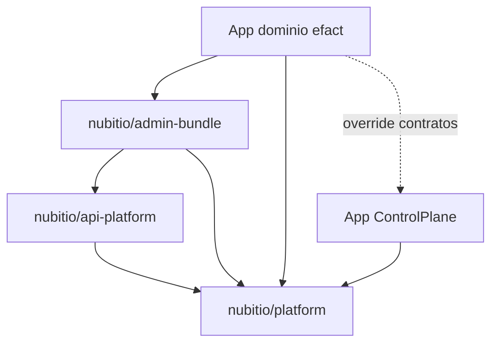

# Mapa de frontera Platform (SPEC-004)

Referencia rápida de qué código es portable (`Nubit\Platform`) vs qué permanece en la aplicación efact. El plan de extracción completo está en [nubit-backend-extraction-plan.md](./nubit-backend-extraction-plan.md).

---

## Namespaces

| Namespace | Ubicación actual | Publicable |
|-----------|----------------------------|------------|
| `Nubit\Platform\` | `vendor/nubitio/platform/src/` | Sí (`nubitio/platform`) |
| `Nubit\ApiPlatform\` | `vendor/nubitio/api-platform/src/` | Sí (`nubitio/api-platform`) |
| `Nubit\AdminBundle\` | `vendor/nubitio/admin-bundle/src/` | Sí (`nubitio/admin-bundle`) |
| `App\Efact\` | infra efact-specific post-migración | No |
| `App\ControlPlane\` | SaaS multi-tenant | No |
| `App\Identity\` | efact prod; lógica genérica → bundle | Parcial |
| `App\{Billing,Sales,Catalog,...}\` | Dominio | No |

`src/Core/` está retirado; ver `src/Core/README.md`. Los aliases `App\Core\*` que sigan en `config/services.yaml` son compatibilidad transitoria, no una ubicación activa de código.

---

## Reglas (guard automático)

El script `php scripts/architecture/check-platform-boundary.php` es un guard legacy de la extracción y hoy escanea rutas candidatas locales si existen. La frontera runtime efectiva está en los paquetes Composer `nubitio/*` y los bindings de `config/services.yaml`.

El guard falla si rutas candidatas importan:

- `App\Entity\`, `App\Repository\`, dominios concretos (`Billing`, `Inventory`, …)
- En una ruta Platform local, además: `App\Efact\Config\`, `App\Core\Doctrine\`, etc.

**Ejecutar en CI** tras cambios de frontera o antes de reintroducir shims locales.

---

## Contratos Platform → implementación en efact

| Contrato (`Nubit\Platform`) | Implementación efact | Implementación starter |
|----------------------------|----------------------|-------------------------|
| `TenantRegistryInterface` | `ControlPlane\Tenant\Application\TenantRegistry` | Noop single-tenant |
| `TenantConnectionSwitcherInterface` | `ControlPlane\Tenant\Service\TenantConnectionSwitcher` | Noop |
| `FeatureCheckerInterface` | `ControlPlane\Billing\Feature\TenantFeatureChecker` | Allow-all / noop |
| `QuotaEnforcerInterface` | `ControlPlane\Billing\Service\TenantQuotaService` | Noop |
| `QuotaResourceResolverInterface` | `ControlPlane\Billing\Quota\EfactEntityQuotaResourceResolver` | Noop |

Bindings en `config/services.yaml` (sección SPEC-004/005).

---

## Bridge CRUD (no es Platform)

Estos componentes **no** viven en `Nubit\Platform`; viven en `nubitio/api-platform`:

- `DataGridFilter`
- `TranslatedDocumentationNormalizer` (`x-crud`)
- `ApiResponseListener` (`X-Total-Count`)

Sin ellos, `@nubit/hydra` y el grid de `@nubit/crud` no coinciden con el backend.

---

## Diagrama de dependencias permitidas

**Prohibido:** `PLAT --> APP` o `PLAT --> CP`.
