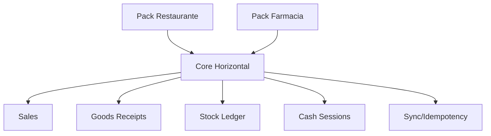

# eFact Refactor Plan: Core Horizontal + Vertical Packs

**Fecha:** 2026-02-28  
**Estado:** Arquitectura objetivo + plan incremental sin downtime

## 1. Resumen (10 bullets)

1. eFact es un SaaS POS multi-tenant en transicion hibrida (legacy + V2).
2. Existe deuda por mezclar reglas verticales en el core transaccional.
3. Ventas, caja e inventario V2 ya tienen base robusta para escalar.
4. Compras/ingresos siguen en legacy (`movimiento tipo_id=1`) y deben separarse.
5. Inventario enterprise requiere mas dominios que compra/venta (mermas, ajustes, vencimientos, transferencias, devoluciones).
6. El ledger (`stock_movements`) debe mantenerse como unica fuente de verdad.
7. Se requiere feature management por tenant para rollout controlado.
8. La meta arquitectonica es Core estable + contratos de extension + packs verticales.
9. El plan debe ser incremental con coexistencia y rollback por tenant.
10. Exito: agregar nuevos verticales tocando minimamente el core.

## 2. Assumptions

- Stack backend: Symfony + Doctrine + Messenger.
- Frontend modular por features.
- Aislamiento tenant actual: database-per-tenant.
- V2 convivira temporalmente con legacy durante migracion.
- No se permite downtime significativo.

---

## A) Inventario y mapa actual

### Dominios detectados

- Comercial: `sales`, `sale_items`, `sale_payments`, `sale_discounts`, `sale_taxes`.
- Caja: `cash_sessions`, `cash_movements`, `cash_counts`.
- Inventario: `stock_movements`, `stock_balances`, `stock_transfers`.
- Devoluciones: `returns`, `return_items`, `refund_payments`.
- Reporteria: `*_daily_summary`.
- Offline/sync: `sync_inbox`, `sync_outbox_server`, `conflict_resolutions`.
- Legacy activo: `movimiento`, `movimiento_detalle`, `cash_shift`, `product_stock`.

### Capabilities y localizacion

- Venta POS: `SaleProcessor` + `SalesWriteGateway`.
- Caja diaria: `cash_sessions`/`cash_movements` con compatibilidad legacy.
- Inventario ledger-first: `InventoryLedgerService`.
- Inbound (compra/ingreso): pagina `Inbound` via endpoint legacy `movements`.

### Acoplamientos y anti-patterns

- Tabla `movimiento` sobrecargada para distintos conceptos de negocio.
- Reglas operativas de vertical dentro de flows core.
- Compatibilidad legacy y V2 mezclada en un mismo processor.
- Flags ambiguos globales para politicas que requieren granularidad.

---

## B) Definicion de Core (V1)

### Core obligatorio

- Identidad, tenant, usuarios, roles, permisos.
- Catalogo base: productos, clientes, proveedores, sucursales, almacenes.
- Transacciones horizontales:
  - ventas/devoluciones,
  - caja,
  - inventario ledger,
  - compras base (nuevo V2 en Fase 1).
- Motor offline/idempotencia/versionado.
- Feature flags por tenant.

### Fuera del core (packs)

- Restaurante (mesas/comandas/cocina).
- Farmacia (lotes, vencimientos, trazabilidad y reglas regulatorias).

### Contratos de extension

- Interfaces propuestas:
  - `VerticalRuleContributorInterface`
  - `InventoryMovementPolicyInterface`
  - `TaxEnrichmentProviderInterface`
  - `MenuRoutePackProviderInterface`
- Eventos base:
  - `SaleCompleted`, `SaleVoided`, `ReturnCompleted`
  - `GoodsReceiptPosted`
  - `StockMovementRecorded`
  - `CashSessionOpened/Closed`

### Feature flags por tenant

- `feature_definitions`
- `tenant_feature_overrides`
- `feature_audit_log`
- Cache por tenant con invalidacion por evento.

---

## C) Vertical packs

### Restaurante

**Incluye:** mesas, ordenes, kitchen tickets, split bill.  
**No incluye:** caja/inventario/fiscal base.

### Farmacia

**Incluye:** lotes, expiracion FEFO, controles regulatorios.  
**No incluye:** venta/caja base.

---

## D) Plan de migracion (sin romper produccion)

### Fase 0

- Observabilidad, reconciliaciones, flags y SLO.

### Fase 1 (actual)

- Crear `goods_receipts` + `goods_receipt_items`.
- Dual-write desde flujo inbound actual (`movimiento tipo_id=1`).
- Mantener UI/endpoint existentes sin quiebre.

### Fase 2

- Separar API inbound a endpoint V2 de compras.
- Mantener strangler con fallback legacy temporal.

### Fase 3+

- Inventario 360: ajustes, mermas, devolucion proveedor, conteos, vencimientos.
- Empaquetado vertical restaurante/farmacia.
- Sunset legacy por olas de tenants.

---

## E) Recomendaciones de calidad

- Regla de oro: Core no depende de packs.
- Todo cambio de inventario pasa por ledger.
- Contract tests para extensiones.
- Reconciliacion y health-score por tenant diarios.
- Checklist PR:
  - no `if vertical` en core,
  - evento emitido,
  - flag + rollback,
  - tests + metricas.

---

## F) Roadmap y prioridad

### Quick wins (1-2 semanas)

1. Compras V2 dual-write desde inbound actual.
2. Politica formal de stock negativo (`BLOCK` por defecto).
3. Auditoria de excepciones de stock.

### Impacto vs esfuerzo

- Alto impacto / S-M: Compras V2, politica stock.
- Alto impacto / M-L: Inventario 360.
- Alto impacto / L: Packs verticales completos.

---

## Mermaid: Context map objetivo

